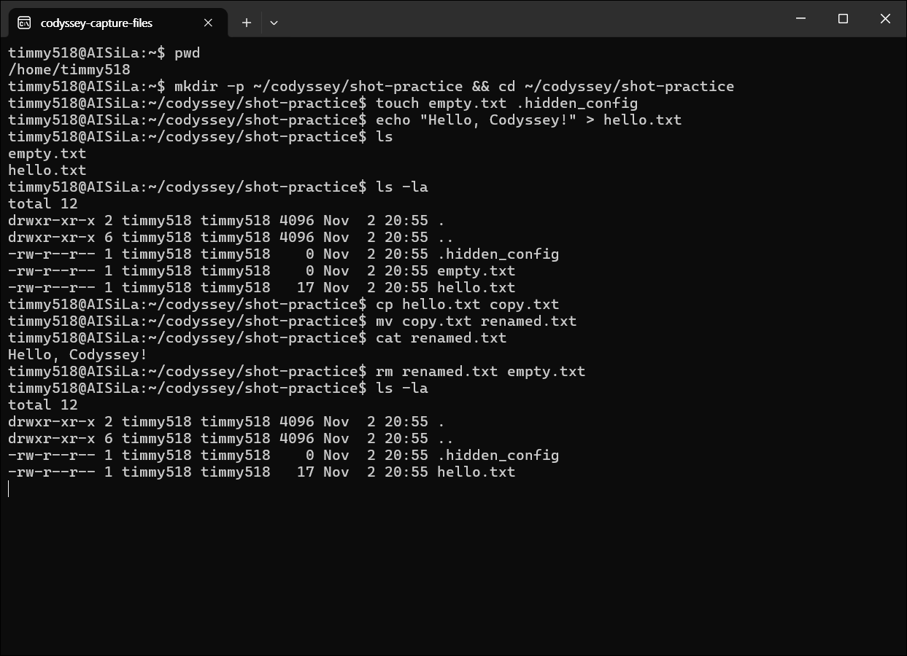
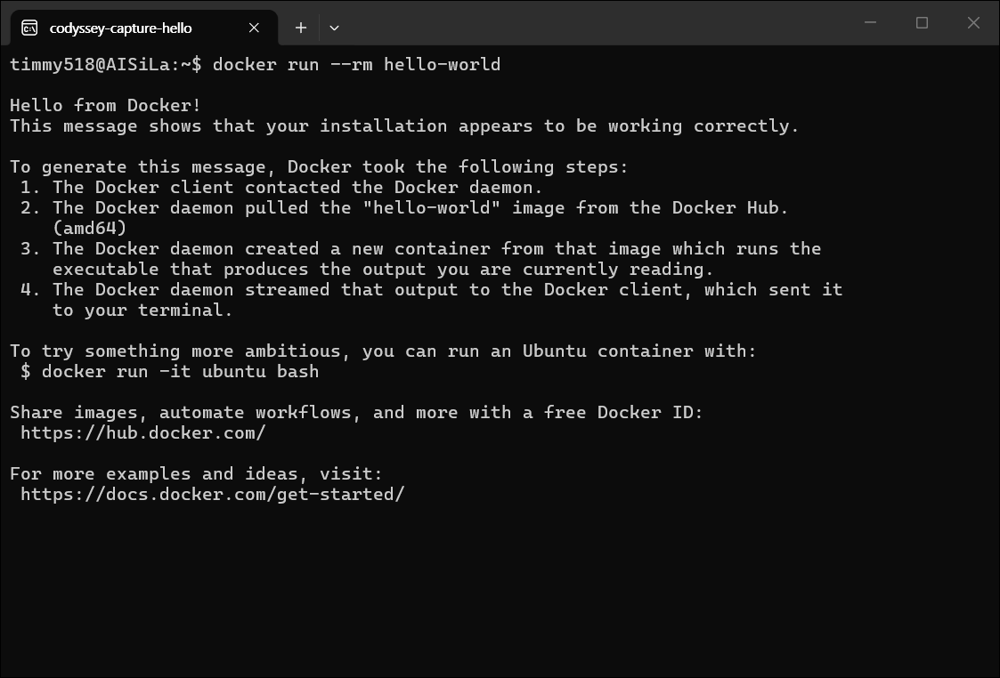
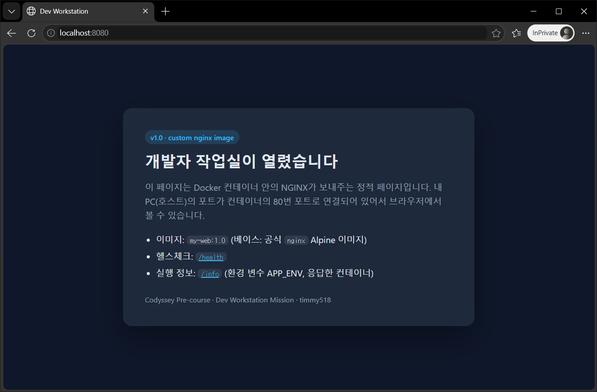
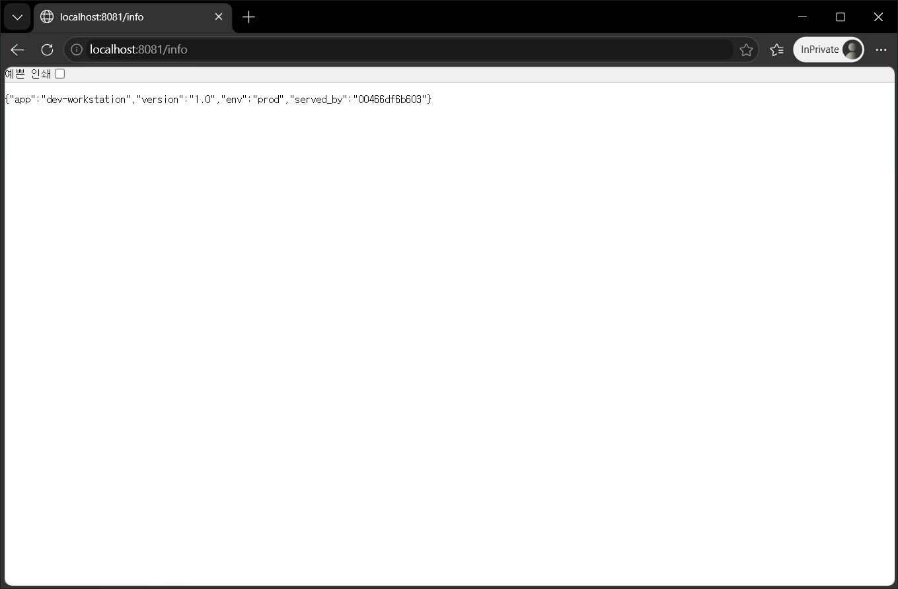
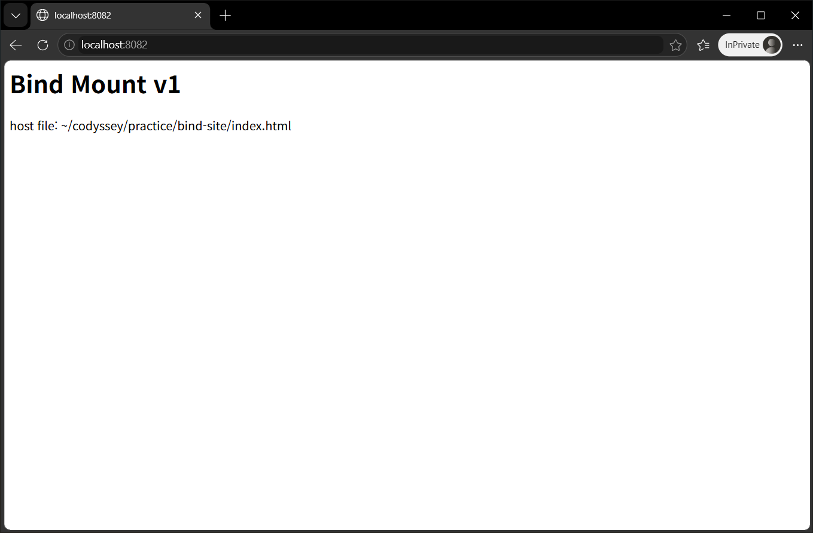
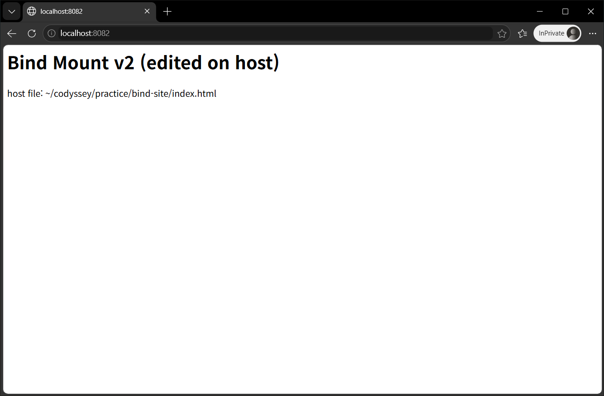
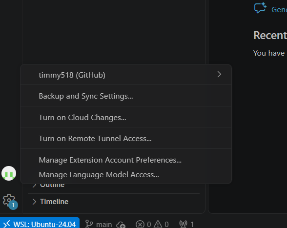
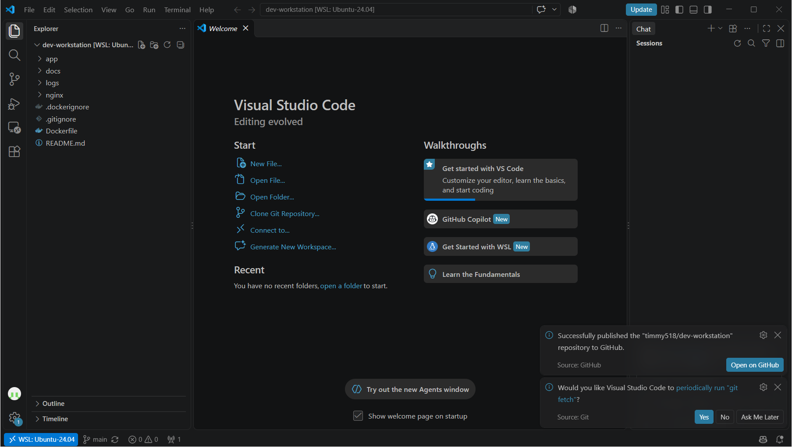

# 내 컴퓨터에 개발자용 '작업실' 꾸미기 — Dev Workstation

Codyssey 입학연수 미션 수행 기록입니다. Windows 11 PC에 WSL2(Windows 안에서 리눅스를 실행하는 기능)로 Ubuntu를 올리고, 그 안에 Docker Engine을 설치해 Git·VS Code와 함께 쓰는 개발 환경을 만들었습니다. 미션의 각 항목이 실제로 동작하는지 명령과 출력으로 확인했습니다.

- 저장소(공개): https://github.com/timmy518/Codyssey_E_1-1
- 작성·실행: 사용자 요청에 따라 Claude가 코드·문서 작성과 실습 명령 실행을 했습니다.
- 명령과 출력 전체는 [`logs/`](logs/)에 단계별 파일로, 캡처 8장은 [`docs/images/`](docs/images/)에 있습니다. 이 문서에는 핵심만 발췌했습니다. `PS>`로 시작하는 줄은 Windows PowerShell에서 실행한 명령입니다.

## 목차

1. [프로젝트 개요](#1-프로젝트-개요)
2. [실행 환경](#2-실행-환경)
3. [수행 항목 체크리스트](#3-수행-항목-체크리스트)
4. [저장소 구조](#4-저장소-구조)
5. [수행 기록 (명령 + 결과)](#5-수행-기록-명령--결과)
   - [5.1 터미널 기본 조작](#51-터미널-기본-조작) · [5.2 권한 실습](#52-권한-실습) · [5.3 Docker 설치](#53-docker-설치) · [5.4 Docker 설치 점검](#54-docker-설치-점검) · [5.5 Docker 기본 운영 명령](#55-docker-기본-운영-명령) · [5.6 컨테이너 실행 실습](#56-컨테이너-실행-실습)
   - [5.7 Dockerfile 커스텀 이미지](#57-dockerfile-커스텀-이미지) · [5.8 포트 매핑과 접속 증거](#58-포트-매핑과-접속-증거) · [5.9 바인드 마운트 반영](#59-바인드-마운트-반영) · [5.10 Docker 볼륨 영속성](#510-docker-볼륨-영속성) · [5.11 Git 설정과 GitHub / VS Code 연동](#511-git-설정과-github--vs-code-연동)
6. [검증 방법 요약](#6-검증-방법-요약)
7. [트러블슈팅](#7-트러블슈팅)
8. [보안·개인정보 처리](#8-보안개인정보-처리)
9. [개념 정리 (과제 목표)](#9-개념-정리-과제-목표)
10. [재현 방법](#10-재현-방법)
11. [로그 기록 방식](#11-로그-기록-방식)

---

## 1. 프로젝트 개요

미션 목표를 요약하면 아래 다섯 가지입니다. 항목별 검증 결과와 증거 링크는 [6장](#6-검증-방법-요약)에 모았습니다.

- 터미널로 작업 디렉토리를 만들고 파일을 다루며, 파일·디렉토리 권한을 바꿔 봅니다.
- Docker를 설치·점검하고 이미지와 컨테이너를 실행·관리합니다.
- 기존 이미지(NGINX)를 바탕으로 Dockerfile을 작성해 커스텀 웹 서버 이미지를 만듭니다.
- 포트 매핑으로 접속을 확인하고, 바인드 마운트(호스트 폴더를 컨테이너에 연결)의 변경 반영과 볼륨(Docker가 관리하는 저장 공간)의 데이터 영속성을 검증합니다.
- Git을 설정하고 VS Code에서 GitHub에 연동해, 이 저장소와 기술 문서(README)로 결과를 제출합니다.

---

## 2. 실행 환경

- **호스트 OS**: Windows 11 Home Single Language 25H2 (빌드 10.0.26200.9711) — 확인: `(Get-CimInstance Win32_OperatingSystem).Caption`, `Get-ItemPropertyValue … DisplayVersion`, `wsl --version`
- **WSL**: WSL 3.0.3.0, `Ubuntu-24.04`를 VERSION 2(WSL2)로 실행, 네트워크 모드 `nat` — 확인: `wsl --version`, `wsl -l -v`, `wslinfo --networking-mode`
- **커널**: 6.18.54.1-microsoft-standard-WSL2 — 확인: `uname -r`
- **배포판**: Ubuntu 24.04.5 LTS (noble) — 확인: `grep -E … /etc/os-release`
- **init (PID 1)**: systemd (Docker 서비스를 `systemctl`로 관리) — 확인: `ps -p 1 -o comm=`
- **셸**: bash 5.2.21(1)-release — 확인: `echo $BASH_VERSION`
- **터미널**: Windows Terminal 1.24.12741.0, VS Code 통합 터미널 — 확인: `(Get-AppxPackage Microsoft.WindowsTerminal).Version`
- **Docker**: Docker Engine - Community 29.9.2 (Client·Server). Docker Desktop이 아니라 Ubuntu 안에 공식 apt 저장소로 설치 — 확인: `docker --version`, `docker version`, `docker info` ([04 로그](logs/04_docker_check.log))
- **Git**: 2.43.0 — 확인: `git --version`
- **VS Code**: 1.143.1 (x64), WSL 모드로 Ubuntu에 연결(`WSL: Ubuntu-24.04`) — 확인: `code --version`, [5.11 캡처](#511-git-설정과-github--vs-code-연동)

```bash
PS> wsl -l -v  # VERSION 2 = WSL2
  NAME            STATE           VERSION
* Ubuntu-24.04    Running         2
...
timmy518@AISiLa:~$ grep -E "^(PRETTY_NAME|VERSION_CODENAME)=" /etc/os-release
PRETTY_NAME="Ubuntu 24.04.5 LTS"
...
timmy518@AISiLa:~$ echo $BASH_VERSION
5.2.21(1)-release
...
timmy518@AISiLa:~$ docker --version
Docker version 29.9.2, build a82e528
timmy518@AISiLa:~$ git --version
git version 2.43.0
```

전체 로그: [`logs/00_environment.log`](logs/00_environment.log)

**이렇게 구성한 이유 — 왜 리눅스이고, 왜 Ubuntu 위에 Docker인가**

구성 순서는 Windows 11 → WSL2(리눅스 커널) → Ubuntu 24.04(Docker 호스트) → Docker Engine → 컨테이너입니다. 위 목록의 '호스트 OS'는 WSL2를 돌리는 Windows이고, 이 아래와 5장 이후의 '호스트'는 컨테이너 바깥의 Ubuntu를 말합니다.

- **리눅스를 쓴 이유** — 이 미션의 컨테이너(nginx·ubuntu 이미지)는 리눅스 컨테이너라 리눅스 커널 기능(네임스페이스: 프로세스·네트워크 공간 분리, cgroup: CPU·메모리 사용 제한)으로 만들어지고, 그래서 Docker 엔진도 리눅스 커널 위에서 돕니다(`docker info`의 `OSType: linux`, [04 로그](logs/04_docker_check.log) 84행). Windows용 Docker Desktop도 기본 설정(WSL2 방식)에서는 엔진을 자기 전용 `docker-desktop` WSL 배포판 안에서 돌리고([Docker 문서](https://docs.docker.com/desktop/features/wsl/)), macOS의 OrbStack·Docker Desktop도 안에 가벼운 리눅스 VM을 띄웁니다. 미션이 핵심 도구로 꼽은 것도 리눅스 터미널이고, 서버·CI·클라우드도 대부분 리눅스라 여기서 익힌 명령과 권한 개념을 그대로 씁니다. 파일 권한(r/w/x) 실습도 리눅스 파일 시스템에서 해야 제대로 됩니다(Windows 드라이브에서는 모든 파일이 777로 보임 — [7-3](#7-3-windows-드라이브에서-가져온-파일에-실행-권한이-붙음)).
- **Docker를 Ubuntu 위에 올린 이유(그 반대가 아닌 이유)** — Docker 엔진은 운영체제 위에서 도는 서비스이고, 컨테이너는 그 엔진이 호스트 커널을 함께 써서 띄우는 격리된 프로세스라 순서가 'OS → Docker → 컨테이너'입니다(`docker info`의 `Operating System: Ubuntu 24.04.5 LTS`, `Kernel Version: 6.18.54.1-microsoft-standard-WSL2`, [04 로그](logs/04_docker_check.log) 82–83행). Windows에 Docker Desktop을 먼저 깔고 Ubuntu 컨테이너를 쓰는 방식도 실제 구조는 Windows → WSL2 → `docker-desktop`(리눅스) → Docker → Ubuntu 컨테이너라, 어느 쪽이든 Docker 밑에는 리눅스가 있습니다. 'Docker 위의 Ubuntu'인 Ubuntu 컨테이너([5.6](#56-컨테이너-실행-실습)의 `docker run -it --name ubuntu-shell ubuntu:24.04 bash`)는 커널 없이 Ubuntu의 파일과 명령만 담은 실행 환경입니다. 호스트 Ubuntu의 PID 1은 systemd이지만(위 init 항목), 컨테이너의 PID 1은 `docker run`에 적은 bash였고(5.6 attach의 `my PID is 1`), 그 bash가 끝나면 컨테이너 전체가 멈췄습니다(`attach-exit-demo` → `Exited (0)`). 볼륨 없이 컨테이너의 쓰기 층에 쓴 파일은 컨테이너를 지우면 함께 사라지고([5.10](#510-docker-볼륨-영속성)의 '비교: 볼륨 없이 쓴 파일'), 볼륨이나 바인드 마운트로 남긴 데이터도 결국 호스트 Ubuntu에 저장됩니다(볼륨 `web-data`의 실제 위치 `/var/lib/docker/volumes/web-data/_data`, 바인드 마운트는 호스트 폴더 — [5.9](#59-바인드-마운트-반영)). 그래서 오래 남아야 하는 작업 공간(Git 저장소, 로그, 권한 실습 파일)은 처음부터 호스트 Ubuntu에 두고, 컨테이너는 웹 서버처럼 같은 상태로 언제든 다시 띄울 서비스에 썼습니다.
- **Docker Desktop 대신 Docker Engine을 직접 설치한 이유** — 엔진이 서버에서처럼 systemd 서비스로 돌아, 데몬 상태(`systemctl is-active docker`)·권한(`id -nG`의 `docker` 그룹, `docker.sock`의 그룹 `docker`)·저장 위치(`Docker Root Dir: /var/lib/docker`, 내 Ubuntu 안의 폴더)를 명령으로 직접 확인할 수 있습니다([5.3](#53-docker-설치), [04 로그](logs/04_docker_check.log) 90·103–111행). Windows에 별도 앱을 깔지 않고 Ubuntu의 apt로 다른 패키지처럼 설치·업데이트합니다(Docker Desktop은 개인·교육용은 무료지만 큰 회사에서는 유료 구독이 필요합니다).

**PC 환경에 따른 차이 (재현 시 주의)**

- 미션 안내의 OrbStack은 macOS용이라, 이 PC(Windows)는 WSL2 Ubuntu 안에 Docker Engine을 설치했습니다. macOS는 OrbStack(또는 Docker Desktop)을 쓰고 WSL 단계를 건너뛰면 되며, 그 뒤의 `docker` 명령은 같습니다.
- Windows에서 WSL2를 처음 켜면 재부팅이 한 번 필요합니다([7-2](#7-2-설치-직후-wsl2가-시작되지-않음)).
- 로그의 `timmy518`(사용자명), `AISiLa`(PC 이름), `/home/timmy518`은 작성자 PC 기준입니다. `~`, `$HOME`, `$USER`로 바꿔 읽습니다.
- `~/codyssey/dev-workstation`은 작성자 PC의 저장소 폴더입니다(처음 게시한 저장소 이름과 같음). [10장](#10-재현-방법)대로 clone하면 `~/Codyssey_E_1-1`이므로 그 경로로 바꿔 읽습니다.
- Docker 설치([5.3](#53-docker-설치)) 로그는 root 셸에서 기록했습니다. 일반 사용자 명령은 5.3의 **일반 사용자로 따라 하기**에 있습니다.

---

## 3. 수행 항목 체크리스트

- [x] 터미널 기본 조작 — 위치 `pwd`, 목록 `ls -la`(숨김 포함), 이동 `cd`(절대·상대 경로), 생성 `mkdir`·`echo >`, 복사 `cp`, 이동/이름 변경 `mv`, 삭제 `rm`·`rmdir`, 내용 `cat`, 빈 파일 `touch`, 터미널 화면 캡처 → [5.1](#51-터미널-기본-조작)
- [x] 권한 실습 — 파일 `hello.sh`·`perm_file.txt`, 디렉토리 `perm_dir`을 `ls -l`·`stat`로 확인하고 `chmod`로 바꿔 전/후 비교(755·644 등) → [5.2](#52-권한-실습)
- [x] Docker 설치·점검 — 공식 apt 저장소로 Docker Engine 설치, `docker --version`, `docker version`(Server 정보로 데몬 동작 확인), `docker info` → [5.3](#53-docker-설치), [5.4](#54-docker-설치-점검)
- [x] Docker 기본 운영 — `pull`, `images`, `run -d`, `ps`, `ps -a`, `logs`, `stats`, `stop`·`start`·`rm` → [5.5](#55-docker-기본-운영-명령)
- [x] 컨테이너 실행 — `hello-world` 실행 성공(터미널 화면 캡처), ubuntu 컨테이너 안에서 `ls`·`echo`, attach와 exec의 종료/유지 차이 → [5.6](#56-컨테이너-실행-실습)
- [x] Dockerfile 커스텀 이미지 — (A) 웹 서버 베이스 `nginx:1.30.6-alpine`에 정적 페이지·설정을 교체한 `my-web:1.0` 빌드·실행, 커스텀 포인트별 목적 정리 → [5.7](#57-dockerfile-커스텀-이미지)
- [x] 포트 매핑 — 같은 이미지를 `-p 8080:80`, `-p 8081:80`으로 두 번 실행해 둘 다 HTTP 200 (`curl`, 브라우저 캡처 2장) → [5.8](#58-포트-매핑과-접속-증거)
- [x] 바인드 마운트 — `-v "$PWD/bind-site":/usr/share/nginx/html`로 실행, 호스트 파일 수정 전/후 비교(`curl`, 캡처 2장) → [5.9](#59-바인드-마운트-반영)
- [x] Docker 볼륨 — `web-data` 생성·연결 후 데이터 쓰기, 컨테이너 삭제 뒤 새 컨테이너에서 같은 데이터 확인, 백업 tar 파일로 새 볼륨에 복원(보충) → [5.10](#510-docker-볼륨-영속성)
- [x] Git 설정 — `user.name`, `user.email`, `init.defaultBranch main` 설정 후 `git config --list` → [5.11](#511-git-설정과-github--vs-code-연동)
- [x] GitHub / VS Code 연동 — VS Code(WSL 모드)에서 GitHub 로그인 후 공개 저장소로 게시(캡처 2장), 최종본은 VS Code 터미널의 `git push`로 이 저장소에 올림 → [5.11](#511-git-설정과-github--vs-code-연동)
- [x] 실행 환경 기록 — Windows(PowerShell)·Ubuntu(bash)에서 OS·WSL·셸·터미널·Docker·Git·VS Code 버전 확인 → [2](#2-실행-환경)
- [x] 트러블슈팅 6건(문제 → 원인 가설 → 확인 → 해결/대안) — WSL 설치·시작, 파일 실행 권한, 포트 충돌, VS Code 로그인, PowerShell에서 WSL로 명령 전달 → [7](#7-트러블슈팅)
- [x] 민감정보 점검 — 파일·커밋 히스토리에서 토큰·개인키 모양 검색 0건, 원격 주소에 토큰 없음, 스크린샷 8장 확인 → [8](#8-보안개인정보-처리)

---

## 4. 저장소 구조

```text
Codyssey_E_1-1/                       # 작성자 PC에서는 ~/codyssey/dev-workstation
├── README.md                         # 기술 문서 (이 파일)
├── Dockerfile                        # 커스텀 이미지 정의 (베이스 nginx:1.30.6-alpine)
├── .dockerignore                     # 빌드 컨텍스트에서 뺄 파일 (.git·문서·로그·비밀 파일)
├── .gitignore                        # 커밋하지 않을 파일 (OS·에디터 파일, .env·키 파일)
├── app/index.html                    # 웹 서버 소스 (정적 페이지)
├── nginx/default.conf.template       # NGINX 설정 템플릿 (/health, /info, 응답 헤더)
├── logs/                             # 단계별 명령 + 출력 (기록 방식은 11장)
│   ├── 00_environment.log            # 2장 실행 환경 (끝부분은 재기록 전 초기화)
│   ├── 01_terminal.log ~ 11_git.log  # 5.1 ~ 5.11 (번호 = 절 번호, 08에는 7-4도 있음)
│   ├── 12_troubleshooting.log        # 7-3 재현, 7-6 (b) 원인 확인
│   └── 13_secret_check.log           # 8장 민감정보 점검
└── docs/images/                      # 캡처 8장 (5.1·5.6·5.8·5.9·5.11)
```

실습 폴더 `~/codyssey/practice`(5.1·5.2·5.9, 5.10의 백업 파일이 든 `volume-backup/`)는 저장소 밖에 두어 커밋하지 않았습니다.

---

## 5. 수행 기록 (명령 + 결과)

각 절은 **한 일 → 핵심 명령과 출력 → 확인 포인트 → 전체 로그 링크** 순서입니다. 프롬프트가 있는 코드 블록의 명령과 출력은 [`logs/`](logs/)의 로그에서 그대로 옮겼습니다.
- 프롬프트(`사용자@호스트:현재 위치$`, 예: `timmy518@AISiLa:~$`) 뒤가 실행한 명령이고, 그 아래 줄이 출력입니다. `root@AISiLa:~#`은 관리자(root) 셸, `PS>`는 Windows PowerShell입니다. 명령 끝의 `# ...`는 이 문서에서 붙인 설명이고(로그에는 없음), `...`는 줄인 부분입니다(`#5`·`## main…`처럼 줄 맨 앞이 `#`인 줄은 실제 출력). `[exit code: N]`은 바로 위 명령이 실패했을 때의 종료 코드입니다. 실패 메시지의 `bash: line 1:`은 기록 방식 때문이며, 직접 입력하면 `bash:`로 나옵니다([11. 로그 기록 방식](#11-로그-기록-방식)). 본문의 `11의 # 7)`·`00의 [3]` 같은 위치 표기는 그 번호 로그 파일에서 `# 7) …`·`# [3] …` 설명 줄로 시작하는 구간입니다.
- 작성자 PC 값(`timmy518`, `AISiLa`, `~/codyssey/dev-workstation`)은 [2장의 재현 시 주의](#2-실행-환경)대로 바꿔 읽습니다.
- 로그 발췌는 기록이라 프롬프트와 설명이 섞여 있어 그대로 붙여 넣는 용도가 아닙니다. Docker 결과는 [10장](#10-재현-방법)의 명령 블록으로 따라 하고(볼륨 백업·복원만은 10장 안내대로 [5.10](#510-docker-볼륨-영속성)의 명령을 입력), 5.1·5.2는 로그 01·02의 프롬프트 뒤 명령을 순서대로 입력하세요(macOS 기본 셸 zsh에서는 줄 끝 `# 설명`도 명령으로 들어가므로 빼고 입력합니다).

### 5.1 터미널 기본 조작

홈 아래에 실습 폴더 `~/codyssey/practice`를 만들고, 미션의 기본 조작(위치 확인·목록·이동·생성·복사·이동/이름 변경·삭제·내용 확인·빈 파일 생성)을 모두 명령으로 수행했습니다.

```bash
timmy518@AISiLa:~$ pwd  # 현재 위치 확인
/home/timmy518
timmy518@AISiLa:~$ mkdir -p ~/codyssey/practice  # -p: 중간 디렉토리까지 함께 생성
timmy518@AISiLa:~$ cd codyssey/practice  # 상대 경로로 이동
timmy518@AISiLa:~/codyssey/practice$ pwd
/home/timmy518/codyssey/practice
timmy518@AISiLa:~/codyssey/practice$ touch empty.txt  # 빈 파일 생성
timmy518@AISiLa:~/codyssey/practice$ echo "Hello, Codyssey!" > hello.txt  # 내용 있는 파일 생성
timmy518@AISiLa:~/codyssey/practice$ touch .hidden_config  # 숨김 파일(이름이 .으로 시작)
timmy518@AISiLa:~/codyssey/practice$ ls  # 옵션 없이: 숨김 파일은 안 보임
empty.txt
hello.txt
timmy518@AISiLa:~/codyssey/practice$ ls -la  # -a: 숨김 파일까지 표시
total 12
drwxr-xr-x 2 timmy518 timmy518 4096 Nov  2 13:46 .
drwxr-xr-x 4 timmy518 timmy518 4096 Nov  2 13:46 ..
-rw-r--r-- 1 timmy518 timmy518    0 Nov  2 13:46 .hidden_config
-rw-r--r-- 1 timmy518 timmy518    0 Nov  2 13:46 empty.txt
-rw-r--r-- 1 timmy518 timmy518   17 Nov  2 13:46 hello.txt
...
timmy518@AISiLa:~/codyssey/practice$ wc -c empty.txt hello.txt  # 바이트 수
 0 empty.txt
17 hello.txt
17 total
timmy518@AISiLa:~/codyssey/practice$ mkdir docs backup  # 디렉토리 생성
timmy518@AISiLa:~/codyssey/practice$ cp hello.txt backup/hello_copy.txt  # 파일 복사
timmy518@AISiLa:~/codyssey/practice$ cp -r backup backup_copy  # 디렉토리째 복사
...
timmy518@AISiLa:~/codyssey/practice$ mv hello.txt docs/  # 이동
timmy518@AISiLa:~/codyssey/practice$ mv docs/hello.txt docs/greeting.txt  # 이름 변경
...
timmy518@AISiLa:~/codyssey/practice$ cat docs/greeting.txt  # 내용 확인
Hello, Codyssey!
timmy518@AISiLa:~/codyssey/practice$ cd /home/timmy518/codyssey/practice/docs  # 절대 경로로 이동
timmy518@AISiLa:~/codyssey/practice/docs$ pwd
/home/timmy518/codyssey/practice/docs
...
timmy518@AISiLa:~/codyssey/practice$ rm backup/hello_copy.txt  # 파일 삭제
timmy518@AISiLa:~/codyssey/practice$ rmdir backup  # 빈 디렉토리 삭제
timmy518@AISiLa:~/codyssey/practice$ rm -r backup_copy  # 내용이 있는 디렉토리 삭제
timmy518@AISiLa:~/codyssey/practice$ rm empty.txt
timmy518@AISiLa:~/codyssey/practice$ ls -la  # 삭제 후 확인
...
-rw-r--r-- 1 timmy518 timmy518    0 Nov  2 13:46 .hidden_config
drwxr-xr-x 2 timmy518 timmy518 4096 Nov  2 13:46 docs
```

**확인 포인트**

- **숨김·빈 파일**: 옵션 없는 `ls`에는 안 보이던 숨김 파일 `.hidden_config`가 `ls -la`에는 보이고, `touch`로 만든 `empty.txt`는 크기와 `wc -c`가 모두 `0`입니다.
- **복사·이동·삭제**: 복사 직후 `backup`과 `backup_copy`에 모두 `hello_copy.txt`가 있었고([01 로그](logs/01_terminal.log) 52–63행), `mv` 두 번으로 `hello.txt`가 내용 그대로 `docs/greeting.txt`가 되었으며, 삭제 뒤에는 `.hidden_config`와 `docs`만 남았습니다.
- **절대·상대 경로**: `~`에서 실행한 상대 경로 `cd codyssey/practice`와 절대 경로 `cd /home/timmy518/codyssey/practice/docs` 뒤의 `pwd`가 각각 도착 위치를 보여 줍니다(차이는 [9장](#9-개념-정리-과제-목표)).

**터미널 화면** — 같은 기록 방식([11장](#11-로그-기록-방식))으로 Windows Terminal에서 주요 파일 명령을 다시 실행한 화면입니다(캡처용으로 따로 만든 폴더).



전체 로그: [`logs/01_terminal.log`](logs/01_terminal.log)

### 5.2 권한 실습

파일 2개(`hello.sh`, `perm_file.txt`)와 디렉토리 1개(`perm_dir`, 안에 `inside.txt`)를 새로 만들고, `chmod`(권한 변경 명령)로 권한을 바꾸며 `stat -c '%A (%a) %n'`(권한을 기호와 숫자로 출력)으로 변경 전/후를 비교했습니다.

> **macOS에서 따라 할 때** — macOS의 `stat`(BSD 판)에는 `-c`가 없으므로 `stat -f '%Sp (%OLp) %N' 파일`(소유자까지는 `stat -f '%Sp (%OLp) %Su:%Sg %N' 파일`)을 쓰면 같은 모양으로 나옵니다. 디렉토리 실험은 root가 아닌 일반 사용자로 해야 거부가 재현됩니다(root는 권한 검사를 건너뜀).

```bash
timmy518@AISiLa:~/codyssey/practice$ umask  # 그룹·기타 w 끔: 새 파일 666→644, 새 디렉토리 777→755
0022
...
timmy518@AISiLa:~/codyssey/practice$ stat -c '%A (%a) %U:%G %n' perm_file.txt hello.sh perm_dir
-rw-r--r-- (644) timmy518:timmy518 perm_file.txt
-rw-r--r-- (644) timmy518:timmy518 hello.sh
drwxr-xr-x (755) timmy518:timmy518 perm_dir
...
timmy518@AISiLa:~/codyssey/practice$ ./hello.sh  # [실험 1] 644: 실행 권한(x) 없음
bash: line 1: ./hello.sh: Permission denied
[exit code: 126]
timmy518@AISiLa:~/codyssey/practice$ chmod 755 hello.sh  # 모두에게 x 추가
timmy518@AISiLa:~/codyssey/practice$ stat -c '%A (%a) %n' hello.sh
-rwxr-xr-x (755) hello.sh
timmy518@AISiLa:~/codyssey/practice$ ./hello.sh
hello.sh is running!
...
timmy518@AISiLa:~/codyssey/practice$ chmod 600 perm_file.txt  # [실험 2] 소유자만 읽기·쓰기
timmy518@AISiLa:~/codyssey/practice$ stat -c '%A (%a) %n' perm_file.txt
-rw------- (600) perm_file.txt
timmy518@AISiLa:~/codyssey/practice$ chmod 644 perm_file.txt  # 되돌림
...
timmy518@AISiLa:~/codyssey/practice$ chmod 644 perm_dir  # [실험 3] 디렉토리에서 x 제거
timmy518@AISiLa:~/codyssey/practice$ stat -c '%A (%a) %n' perm_dir
drw-r--r-- (644) perm_dir
timmy518@AISiLa:~/codyssey/practice$ cd perm_dir
bash: line 1: cd: perm_dir: Permission denied
[exit code: 1]
timmy518@AISiLa:~/codyssey/practice$ cat perm_dir/inside.txt
cat: perm_dir/inside.txt: Permission denied
[exit code: 1]
...
timmy518@AISiLa:~/codyssey/practice$ chmod 755 perm_dir  # 되돌림
...
timmy518@AISiLa:~/codyssey/practice$ cat perm_dir/inside.txt
secret inside
timmy518@AISiLa:~/codyssey/practice$ chmod u=rwx,g=rx,o= perm_dir  # [실험 4] 기호 방식
timmy518@AISiLa:~/codyssey/practice$ stat -c '%A (%a) %n' perm_dir
drwxr-x--- (750) perm_dir
```

**확인 포인트** (권한 표기 읽는 법은 [9장](#9-개념-정리-과제-목표))

- **파일 2개**: `hello.sh`는 644에서 `Permission denied`(exit 126, 실행 권한 없음)였다가 `chmod 755`로 `x`를 더하자 실행되었고, `perm_file.txt`는 600에서 그룹·기타 자리가 `---`(소유자만 읽기·쓰기)가 된 뒤 644로 돌아왔습니다.
- **디렉토리 1개**: `perm_dir`에서 `x`를 빼자(755 → 644) `cd`와 안의 파일 읽기가 모두 거부(exit 1)되었고, 755로 되돌리자 같은 `cat`이 `secret inside`를 출력했습니다.
- **기호 방식**: `chmod u=rwx,g=rx,o= perm_dir`로 소유자·그룹·기타 권한을 `=`로 지정하자 `drwxr-x---`(750)가 되었습니다. 실험 뒤 `perm_dir`은 755, `perm_file.txt`는 644로 되돌렸습니다([02 로그](logs/02_permissions.log) 101행).

전체 로그: [`logs/02_permissions.log`](logs/02_permissions.log)

### 5.3 Docker 설치

Ubuntu(WSL2) 안에 [Docker 공식 문서](https://docs.docker.com/engine/install/ubuntu/)의 **apt 저장소 방식**으로 Docker Engine을 설치했습니다. 아래 기록은 **관리자(root) 셸**에서 실행해서 프롬프트가 `root@AISiLa:~#`이고 명령 앞에 `sudo`가 없습니다.

```bash
root@AISiLa:~# grep -E "^(PRETTY_NAME|VERSION_CODENAME)=" /etc/os-release  # OS 확인
PRETTY_NAME="Ubuntu 24.04.5 LTS"
VERSION_CODENAME=noble
root@AISiLa:~# ps -p 1 -o comm=  # PID 1(첫 프로세스)이 systemd여야 docker 서비스가 자동으로 시작됨
systemd
...
root@AISiLa:~# ls -l /etc/apt/keyrings/docker.asc  # 1) Docker 공식 GPG 키 등록 결과
-rw-r--r-- 1 root root 3817 Nov  2 13:41 /etc/apt/keyrings/docker.asc
root@AISiLa:~# printf "Types: deb\nURIs: https://download.docker.com/linux/ubuntu\nSuites: %s\nComponents: stable\nSigned-By: /etc/apt/keyrings/docker.asc\n" "$(. /etc/os-release && echo "${UBUNTU_CODENAME:-$VERSION_CODENAME}")" > /etc/apt/sources.list.d/docker.sources  # 2) Docker apt 저장소 추가
...
root@AISiLa:~# DEBIAN_FRONTEND=noninteractive apt-get install -y -qq docker-ce docker-ce-cli containerd.io docker-buildx-plugin docker-compose-plugin > /tmp/docker-apt.log 2>&1; echo "apt-get exit code: $?"; grep -E "^Setting up (docker|containerd)" /tmp/docker-apt.log  # 3) 설치
apt-get exit code: 0
...
root@AISiLa:~# systemctl is-enabled docker  # 4) enabled = 부팅 시 자동 시작
enabled
root@AISiLa:~# systemctl is-active docker  # active = 지금 실행 중
active
```

**확인 포인트**
- GPG 키(받은 패키지가 진짜 Docker 것인지 검증하는 공개키)는 모두 읽을 수 있게(`-rw-r--r--`) 두었고, 저장소 설정의 `Signed-By`가 이 키를 가리키므로 apt는 이 키로 Docker 패키지의 서명을 검증합니다.
- `apt-get exit code: 0`으로 설치가 끝났고(docker·containerd 패키지 6개의 `Setting up` 줄은 전체 로그), `systemctl enable`을 따로 하지 않아도 서비스가 `enabled`·`active`입니다.

전체 로그: [`logs/03_docker_install.log`](logs/03_docker_install.log)

**일반 사용자로 따라 하기 (로그 아님, 참고용)** — 관리자 권한이 필요한 명령 앞에 `sudo`를 붙였고, 기록용 옵션(`-qq`, `DEBIAN_FRONTEND=noninteractive`, 설치 출력을 `/tmp/docker-apt.log`로 보내기)은 뺐습니다.

```bash
sudo apt-get update
sudo apt-get install -y ca-certificates curl
sudo install -m 0755 -d /etc/apt/keyrings
sudo curl -fsSL https://download.docker.com/linux/ubuntu/gpg -o /etc/apt/keyrings/docker.asc
sudo chmod a+r /etc/apt/keyrings/docker.asc
printf "Types: deb\nURIs: https://download.docker.com/linux/ubuntu\nSuites: %s\nComponents: stable\nSigned-By: /etc/apt/keyrings/docker.asc\n" "$(. /etc/os-release && echo "${UBUNTU_CODENAME:-$VERSION_CODENAME}")" | sudo tee /etc/apt/sources.list.d/docker.sources > /dev/null
sudo apt-get update
sudo apt-get install -y docker-ce docker-ce-cli containerd.io docker-buildx-plugin docker-compose-plugin
systemctl is-active docker
sudo usermod -aG docker $USER
```

- `systemctl is-active docker`가 `active`면 데몬이 실행 중입니다. `$USER`는 지금 로그인한 내 사용자명으로 바뀝니다.
- 저장소 파일을 만드는 줄만 `sudo tee`를 쓰는 이유는, `sudo printf ... > 파일`처럼 쓰면 `>`를 `sudo`가 아니라 일반 사용자 권한의 지금 셸이 처리해 `Permission denied`로 실패하기 때문입니다.
- 그룹 변경은 새 로그인부터 적용됩니다. WSL은 터미널을 새로 열고, 일반 Linux는 로그아웃했다가 다시 로그인한 뒤(또는 `newgrp docker`) `id -nG`에 `docker`가 보이는지 확인합니다. WSL에서 안 보이면 PowerShell에서 `wsl --shutdown` 후 Ubuntu를 다시 엽니다.
- `ps -p 1 -o comm=`의 결과가 `systemd`가 아니면 docker 서비스가 자동으로 시작되지 않으므로, Ubuntu의 `/etc/wsl.conf`에 `[boot]` 섹션과 `systemd=true`를 넣고 `wsl --shutdown` 후 다시 엽니다.

> **주의 — `docker` 그룹은 사실상 root 권한입니다.** docker 그룹 사용자는 소켓(`/var/run/docker.sock`)으로 root로 실행되는 데몬에 무엇이든 시킬 수 있어서, 예를 들어 `docker run -v /:/host ...`로 sudo 비밀번호 없이 호스트의 모든 파일을 읽고 고칠 수 있습니다([Linux post-installation steps](https://docs.docker.com/engine/install/linux-postinstall/)). 이 PC는 혼자 쓰는 개인 WSL 개발 환경이라 그룹에 추가했고, 여러 사람이 함께 쓰는 서버라면 필요할 때만 `sudo docker ...`로 실행하거나 [rootless 모드](https://docs.docker.com/engine/security/rootless/)를 검토해야 합니다.

### 5.4 Docker 설치 점검

설치 후 일반 사용자(`timmy518`) 터미널에서 `sudo` 없이 Docker 버전과 데몬 동작을 확인했습니다. 긴 출력은 핵심 줄만 남기고 `...`로 줄였습니다.

```bash
timmy518@AISiLa:~$ docker --version
Docker version 29.9.2, build a82e528
...
timmy518@AISiLa:~$ docker version  # Client와 Server(=데몬) 정보를 함께 출력
Client: Docker Engine - Community
...
Server: Docker Engine - Community
...
timmy518@AISiLa:~$ docker info  # 데몬 상세 정보
...
 Images: 0
 Server Version: 29.9.2
 Storage Driver: overlayfs
...
 Cgroup Version: 2
...
```

**확인 포인트**
- `docker version`에 `Server: Docker Engine - Community` 부분까지 나온 것은 `docker` 명령(CLI)이 데몬에 접속해 응답을 받았다는 뜻이므로, 데몬이 동작 중입니다.
- `docker info`에 `Server Version: 29.9.2`, `Storage Driver: overlayfs`, `Cgroup Version: 2` 같은 데몬 정보가 나오고, `Images: 0`은 [`logs/00_environment.log`](logs/00_environment.log)의 `[3]`에서 앞선 실습의 컨테이너·이미지를 정리한 뒤 기록했기 때문입니다.

전체 로그: [`logs/04_docker_check.log`](logs/04_docker_check.log)

### 5.5 Docker 기본 운영 명령

`ubuntu:24.04`와 `nginx:stable-alpine` 이미지를 받고(`docker pull`), nginx 이미지로 `ops-web` 컨테이너를 실행 → 로그·리소스 확인 → 중지 → 재시작 → 삭제했습니다.

```bash
timmy518@AISiLa:~$ docker pull ubuntu:24.04
...
timmy518@AISiLa:~$ docker images
IMAGE                 ID             DISK USAGE   CONTENT SIZE   EXTRA
nginx:stable-alpine   0e52bd054126       93.5MB           27MB        
ubuntu:24.04          fe81560990fa        119MB         31.7MB        
...
timmy518@AISiLa:~$ docker run -d --name ops-web nginx:stable-alpine  # -d: 백그라운드 실행
059b738907b42f62670a9c125ad58a7849873d0a62d709ef722ee0f0b146c59f
...
timmy518@AISiLa:~$ docker logs --tail 5 ops-web  # 마지막 5줄
...
127.0.0.1 - - [02/Nov/2026:05:49:27 +0000] "GET / HTTP/1.1" 200 896 "-" "Wget" "-"
timmy518@AISiLa:~$ docker stats --no-stream ops-web  # --no-stream: 한 번만 측정
CONTAINER ID   NAME      CPU %     MEM USAGE / LIMIT     MEM %     NET I/O      BLOCK I/O     PIDS
059b738907b4   ops-web   0.00%     11.35MiB / 7.602GiB   0.15%     486B / 84B   0B / 8.19kB   13
timmy518@AISiLa:~$ docker stop ops-web
ops-web
timmy518@AISiLa:~$ docker ps
CONTAINER ID   IMAGE     COMMAND   CREATED   STATUS    PORTS     NAMES
timmy518@AISiLa:~$ docker ps -a
CONTAINER ID   IMAGE                 COMMAND                  CREATED         STATUS                              PORTS     NAMES
059b738907b4   nginx:stable-alpine   "/docker-entrypoint.…"   2 seconds ago   Exited (0) Less than a second ago             ops-web
timmy518@AISiLa:~$ docker start ops-web
ops-web
timmy518@AISiLa:~$ docker ps
CONTAINER ID   IMAGE                 COMMAND                  CREATED         STATUS                  PORTS     NAMES
059b738907b4   nginx:stable-alpine   "/docker-entrypoint.…"   2 seconds ago   Up Less than a second   80/tcp    ops-web
timmy518@AISiLa:~$ docker rm -f ops-web  # -f: 실행 중이어도 강제로 중지 후 삭제
ops-web
```

**확인 포인트**
- `docker stop` 뒤 `docker ps`(실행 중인 것만)에서는 사라지고 `docker ps -a`(종료된 것 포함)에는 `Exited (0)`(정상 종료)으로 남으며, `docker start` 뒤 같은 ID `059b738907b4`가 다시 `Up`이 됩니다.
- `docker logs` 마지막 줄의 `"GET / HTTP/1.1" 200`은 직전에 컨테이너 안에서 `wget`으로 보낸 요청(전체 로그의 `docker exec ops-web wget ...`)이 nginx 접근 로그에 찍힌 것입니다.

전체 로그: [`logs/05_docker_ops.log`](logs/05_docker_ops.log)

### 5.6 컨테이너 실행 실습

`hello-world`를 실행하고 ubuntu 컨테이너 안에서 `ls`·`echo`를 실행한 뒤, `docker run -dit --name <이름> ubuntu:24.04 bash`(`-i` 입력 유지, `-t` 터미널 연결)로 띄운 컨테이너 3개로 `exec`와 `attach`의 차이를 비교했습니다. `-i`·`-t` 없이 `-d`만 주면 bash가 읽을 입력이 없어 곧 `Exited (0)`이 됩니다(로그 끝의 `no-it-demo2`).

```bash
timmy518@AISiLa:~$ docker run hello-world  # 로컬에 없는 이미지는 받아서(pull) 실행
...
Hello from Docker!
...
timmy518@AISiLa:~$ docker run -it --name ubuntu-shell ubuntu:24.04 bash  # 컨테이너 안으로
root@5392105b2b32:/# ls
bin   dev  home  lib64  mnt  proc  run   srv  tmp  var
boot  etc  lib   media  opt  root  sbin  sys  usr
root@5392105b2b32:/# echo "Hello from inside the container"
Hello from inside the container
...
timmy518@AISiLa:~$ docker exec -it exec-demo bash  # 새 bash를 띄워 들어감 → echo 후 exit
root@8bd3bd2d3e64:/# echo "my PID is $$"
my PID is 9
root@8bd3bd2d3e64:/# exit
exit
timmy518@AISiLa:~$ docker ps -a --filter name=exec-demo --format "table {{.Names}}\t{{.Status}}"
NAMES       STATUS
exec-demo   Up 5 seconds
timmy518@AISiLa:~$ docker attach attach-demo  # 메인 bash에 연결 → echo 후 Ctrl+P, Ctrl+Q
root@8d80de17ddf5:/# echo "my PID is $$"
my PID is 1
read escape sequence
timmy518@AISiLa:~$ docker ps -a --filter name=attach-demo --format "table {{.Names}}\t{{.Status}}"
NAMES         STATUS
attach-demo   Up 10 seconds
timmy518@AISiLa:~$ docker attach attach-exit-demo  # 메인 bash에 연결 → echo 후 exit
root@e347a3611276:/# echo "my PID is $$"
my PID is 1

exit
timmy518@AISiLa:~$ docker ps -a --filter name=attach-exit-demo --format "table {{.Names}}\t{{.Status}}"
NAMES              STATUS
attach-exit-demo   Exited (0) 2 seconds ago
```

**확인 포인트**
- `Hello from Docker!`가 나와 설치가 정상이고, 프롬프트가 `root@5392105b2b32:/#`(컨테이너 ID)로 바뀐 컨테이너 안에서 `ls`·`echo`가 실행됐습니다.
- `exec`는 컨테이너 안에 **새 bash**(PID `9`)를 띄우므로, `exit`해도 그 bash만 끝나고 컨테이너는 `Up 5 seconds`로 유지됩니다.
- `attach`는 **메인 프로세스**(PID `1`)에 연결되므로, `Ctrl+P` → `Ctrl+Q`로 빠져나오면(`read escape sequence`) `Up 10 seconds`로 유지되고, `exit`하면 메인 프로세스가 끝나 `Exited (0)`이 됩니다.

**터미널 화면** — `docker run --rm hello-world`를 같은 기록 방식으로 Windows Terminal에서 다시 실행한 화면입니다.



전체 로그: [`logs/06_containers.log`](logs/06_containers.log)

### 5.7 Dockerfile 커스텀 이미지

미션의 (A) 방식(웹 서버 베이스 + 정적 콘텐츠·설정 교체)으로 커스텀 이미지 `my-web:1.0`을 만들었습니다. 베이스는 공식 `nginx:1.30.6-alpine`이고, 정적 페이지([`app/`](app/))와 nginx 설정([`nginx/`](nginx/))만 바꿨습니다. 명령은 저장소 폴더에서 실행했습니다. Dockerfile([`Dockerfile`](Dockerfile)에서 주석과 빈 줄만 뺌)과 커스텀 포인트별 목적은 다음과 같습니다.

```dockerfile
FROM nginx:1.30.6-alpine
LABEL org.opencontainers.image.title="dev-workstation-web" \
      org.opencontainers.image.description="Codyssey pre-course: custom NGINX image (static site + /health + /info)" \
      org.opencontainers.image.authors="timmy518"
ENV APP_ENV=dev
COPY nginx/default.conf.template /etc/nginx/templates/default.conf.template
COPY app/ /usr/share/nginx/html/
EXPOSE 80
HEALTHCHECK --interval=10s --timeout=3s --start-period=5s --retries=3 \
  CMD wget -qO- http://127.0.0.1/health || exit 1
```

**커스텀 포인트와 목적**

- **베이스 버전 고정** (`FROM nginx:1.30.6-alpine`) — 공식 웹 서버 이미지를 그대로 씁니다. 태그를 고정해 언제 빌드해도 NGINX 1.30.6이 들어가고, Alpine 리눅스 기반이라 가볍습니다.
- **정적 페이지 교체** (`COPY app/ /usr/share/nginx/html/`) — 기본 "Welcome to nginx!" 페이지 대신 내 페이지([`app/index.html`](app/index.html))를 웹 루트에 넣습니다.
- **nginx 설정 교체** (`COPY nginx/default.conf.template /etc/nginx/templates/default.conf.template`) — [`nginx/default.conf.template`](nginx/default.conf.template)으로 `/health`(`ok`)·`/info`(실행 정보 JSON) 경로와 `X-Served-By`(응답한 컨테이너)·`X-App-Env` 응답 헤더를 더합니다. 컨테이너가 시작될 때 공식 이미지가 템플릿의 `${APP_ENV}`를 환경 변수 값으로 바꿔 `/etc/nginx/conf.d/default.conf`를 만듭니다.
- **실행 모드** (`ENV APP_ENV=dev`) — 기본값을 넣어 두고, 실행할 때 `-e APP_ENV=prod`로 다시 빌드하지 않고 바꿉니다([5.8](#58-포트-매핑과-접속-증거)의 `web-8081`).
- **메타데이터** (`LABEL org.opencontainers.image.*`) — 제목·설명·작성자를 이미지에 기록합니다(`docker image inspect`로 확인). 이미지 이름 `my-web:1.0`은 `docker build -t`로 붙입니다.
- **포트 문서화** (`EXPOSE 80`) — 컨테이너가 80번에서 요청을 받는다는 기록일 뿐 포트를 열지 않습니다. 실제 연결은 `docker run -p`로 합니다.
- **헬스체크** (`HEALTHCHECK --interval=10s --timeout=3s --start-period=5s --retries=3`) — 10초마다 컨테이너 안에서 `/health`를 호출해, 정상이면 `docker ps`에 `(healthy)`, 3번 연속 실패하면 `unhealthy`로 표시합니다(재시작은 하지 않음).
- **빌드 제외** ([`.dockerignore`](.dockerignore)) — 빌드 컨텍스트(`docker build` 끝의 `.`, Docker에 보내는 빌드 재료)에서 `.git`·`README.md`·`docs/`·`logs/` 등과 비밀 파일 패턴(`**/.env`, `**/.env.*`, `**/*.pem`, `**/*.key`, `**/id_*`)을 빼서, 이미지와 웹 루트에 들어가지 않게 합니다.

**빌드와 결과 확인** — 베이스 원본의 기본 페이지를 본 뒤 `-t my-web:1.0`(이름:태그)으로 빌드하고, 같은 경로의 페이지를 커스텀 이미지에서 다시 확인했습니다.

```bash
timmy518@AISiLa:~/codyssey/dev-workstation$ docker run --rm nginx:1.30.6-alpine cat /usr/share/nginx/html/index.html | grep -o "<title>.*</title>"  # 베이스 원본의 기본 페이지
...
<title>Welcome to nginx!</title>
timmy518@AISiLa:~/codyssey/dev-workstation$ docker build --progress=plain -t my-web:1.0 .
...
#5 [1/3] FROM docker.io/library/nginx:1.30.6-alpine@sha256:0e52bd054126cdc040b1276c0af347aeb02a41b9cfe305d6094767ac30e97949
...
#6 [2/3] COPY nginx/default.conf.template /etc/nginx/templates/default.conf.template
...
#7 [3/3] COPY app/ /usr/share/nginx/html/
...
#8 naming to docker.io/library/my-web:1.0 done
...
timmy518@AISiLa:~/codyssey/dev-workstation$ docker images my-web
IMAGE        ID             DISK USAGE   CONTENT SIZE   EXTRA
my-web:1.0   87679365b5c6       92.7MB         26.1MB        
...
timmy518@AISiLa:~/codyssey/dev-workstation$ docker history --format "table {{.CreatedBy}}\t{{.Size}}" my-web:1.0 | head -n 9  # 위쪽이 최신 기록
CREATED BY                                      SIZE
HEALTHCHECK {Test:[CMD-SHELL wget -qO- http:…   0B
EXPOSE [80/tcp]                                 0B
COPY app/ /usr/share/nginx/html/ # buildkit     24.6kB
COPY nginx/default.conf.template /etc/nginx/…   20.5kB
ENV APP_ENV=dev                                 0B
LABEL org.opencontainers.image.title=dev-wor…   0B
...
timmy518@AISiLa:~/codyssey/dev-workstation$ docker run --rm my-web:1.0 cat /usr/share/nginx/html/index.html | grep -o "<title>.*</title>"  # 같은 경로, 커스텀 이미지
<title>Dev Workstation</title>
```

**확인 포인트**
- 빌드 단계는 `[1/3] FROM`(베이스)과 `[2/3]`·`[3/3] COPY`(설정·페이지) 세 개였고, `naming to docker.io/library/my-web:1.0` 뒤 `docker images`에 `my-web:1.0`(ID `87679365b5c6`)이 생겼습니다.
- `docker history`에서 이 Dockerfile이 더한 줄 중 크기가 있는 새 레이어(파일 변경 묶음)는 `COPY` 두 줄뿐이고, `LABEL`·`ENV`·`EXPOSE`·`HEALTHCHECK`는 `0B`로 이미지 설정에만 기록되었습니다.
- 같은 경로(`/usr/share/nginx/html/index.html`)의 페이지 제목이 베이스의 `Welcome to nginx!`에서 `Dev Workstation`으로 바뀌어, 정적 페이지가 교체된 것을 확인했습니다.

전체 로그: [`logs/07_build.log`](logs/07_build.log) (빌드 재료 목록, `docker image inspect`로 라벨·환경 변수·공개 포트·헬스체크를 확인한 출력 포함). 이 이미지를 웹 서버로 실행해 `(healthy)`와 HTTP 200을 확인한 기록은 [5.8](#58-포트-매핑과-접속-증거)에 있습니다.

### 5.8 포트 매핑과 접속 증거

5.7의 `my-web:1.0`으로 컨테이너를 띄워 포트 매핑(`-p <호스트포트>:<컨테이너포트>`)이 없을 때와 있을 때를 비교하고, Ubuntu와 Windows에서 접속을 확인했습니다. 이 절의 '호스트'는 Docker Engine이 설치된 WSL Ubuntu입니다.

**① 매핑 없이 실행 — 컨테이너는 정상이지만 `localhost`로는 닿지 않음**

```text
timmy518@AISiLa:~/codyssey/dev-workstation$ docker run -d --name web-noport my-web:1.0
761bdf2c30eec1495656bbd98ba13b9435ef51c366e859632409928d88d53503
timmy518@AISiLa:~/codyssey/dev-workstation$ docker ps --filter name=web-noport --format "table {{.Names}}\t{{.Status}}\t{{.Ports}}"
NAMES        STATUS                                     PORTS
web-noport   Up Less than a second (health: starting)   80/tcp
timmy518@AISiLa:~/codyssey/dev-workstation$ curl -sS --max-time 3 http://localhost:80
curl: (7) Failed to connect to localhost port 80 after 0 ms: Couldn't connect to server
[exit code: 7]
timmy518@AISiLa:~/codyssey/dev-workstation$ docker exec web-noport wget -qO- http://127.0.0.1/health
ok
```

**확인 포인트**
- PORTS가 `80/tcp`(Dockerfile의 `EXPOSE` 표시)뿐이고, 호스트 포트와 연결된 표시(`0.0.0.0:…->80/tcp`)가 없습니다.
- 컨테이너 안에서는 `/health`가 `ok`인데, 호스트의 `localhost:80`은 `curl: (7)`(exit 7)로 연결에 실패합니다. 포트 매핑이 필요한 이유는 [9장](#9-개념-정리-과제-목표)에 정리했습니다.

**② `-p`로 실행 — 같은 이미지로 컨테이너 2개, 호스트 포트만 다르게(`web-8081`은 `-e APP_ENV=prod`)**

```bash
timmy518@AISiLa:~/codyssey/dev-workstation$ docker run -d --name web-8080 -p 8080:80 my-web:1.0
5a2248b15e0e76760e5e6292feb15473cf891c86d54f35c867ad3c4d07fc8275
timmy518@AISiLa:~/codyssey/dev-workstation$ docker run -d --name web-8081 -p 8081:80 -e APP_ENV=prod my-web:1.0
00466df6b603d3e452f76be91daffe19f4dba2b87125019326008988db225ee4
timmy518@AISiLa:~/codyssey/dev-workstation$ docker ps --filter name=web-808 --format "table {{.Names}}\t{{.Image}}\t{{.Status}}\t{{.Ports}}"  # 15초 뒤
NAMES      IMAGE        STATUS                    PORTS
web-8081   my-web:1.0   Up 15 seconds (healthy)   0.0.0.0:8081->80/tcp, [::]:8081->80/tcp
web-8080   my-web:1.0   Up 15 seconds (healthy)   0.0.0.0:8080->80/tcp, [::]:8080->80/tcp
...
timmy518@AISiLa:~/codyssey/dev-workstation$ curl -sS http://localhost:8080 | grep -E "<title>|<h1>"
  <title>Dev Workstation</title>
    <h1>개발자 작업실이 열렸습니다</h1>
timmy518@AISiLa:~/codyssey/dev-workstation$ curl -sS -i http://localhost:8080/health  # 헤더 포함
HTTP/1.1 200 OK
...
X-Served-By: 5a2248b15e0e
X-App-Env: dev

ok
timmy518@AISiLa:~/codyssey/dev-workstation$ curl -sS http://localhost:8080/info
{"app":"dev-workstation","version":"1.0","env":"dev","served_by":"5a2248b15e0e"}
timmy518@AISiLa:~/codyssey/dev-workstation$ curl -sS http://localhost:8081/info
{"app":"dev-workstation","version":"1.0","env":"prod","served_by":"00466df6b603"}
timmy518@AISiLa:~/codyssey/dev-workstation$ curl -sS -o /dev/null -w "8080 -> HTTP %{http_code}\n" http://localhost:8080 && curl -sS -o /dev/null -w "8081 -> HTTP %{http_code}\n" http://localhost:8081
8080 -> HTTP 200
8081 -> HTTP 200
```

**확인 포인트**
- PORTS `0.0.0.0:8080->80/tcp`는 호스트의 8080번(모든 IPv4 주소, `[::]`는 IPv6)을 컨테이너의 80번에 연결했다는 뜻이고, 두 컨테이너는 안쪽 포트(80)가 같고 호스트 포트만 다릅니다.
- STATUS `(healthy)`(5.7의 `HEALTHCHECK` 통과), 내 페이지의 `<h1>`, `/health`의 `200 OK`·`ok`, 두 포트의 `HTTP 200`으로 커스텀 이미지가 웹 서버로 정상 응답한 것을 확인했습니다.
- `/info`의 `env`는 8080이 `dev`(Dockerfile 기본값), 8081이 `prod`이고, `served_by`가 두 컨테이너 ID의 앞 12자리와 같아서 한 이미지로 만든 서로 다른 컨테이너가 각각 응답한 것을 알 수 있습니다.

**③ Windows에서 접속 (PowerShell, 브라우저)**

이 PC의 WSL2는 NAT 모드([`logs/00_environment.log`](logs/00_environment.log)의 `wslinfo --networking-mode` → `nat`)이고, 이 모드는 Ubuntu에서 열린 포트를 Windows의 `localhost`로 전달합니다(Windows `localhost:8080` → Ubuntu `0.0.0.0:8080` → `-p 8080:80` → `web-8080`의 80번). Windows PowerShell 5.1의 `curl`은 `Invoke-WebRequest`의 별칭이라 `curl.exe`를 썼고, 브라우저(Edge InPrivate 창)는 주소창과 응답이 함께 보이게 캡처했습니다.

```powershell
PS> curl.exe -s -o NUL -w "Windows -> localhost:8080 HTTP %{http_code}\n" http://localhost:8080
Windows -> localhost:8080 HTTP 200
```

**확인 포인트**
- Windows의 `localhost:8080`도 `HTTP 200`으로, Ubuntu를 거쳐 `web-8080` 컨테이너가 응답했습니다.
- 캡처의 주소창은 위가 `localhost:8080`(커스텀 페이지 "개발자 작업실이 열렸습니다"), 아래가 `localhost:8081/info`(`"env":"prod"`, `"served_by":"00466df6b603"` = web-8081)입니다.





전체 로그: [`logs/08_ports.log`](logs/08_ports.log) — 접근 로그(`docker logs`)·자원 사용량(`docker stats`) 확인, 같은 호스트 포트로 하나 더 띄운 포트 충돌 재현, Windows의 `localhost:8081/info` 응답도 이 로그에 있습니다. 포트 충돌의 원인과 해결은 [7-4](#7-4-포트-충돌-의도적으로-재현)에 정리했습니다.

### 5.9 바인드 마운트 반영

호스트(Ubuntu) 폴더 `~/codyssey/practice/bind-site`를 컨테이너의 웹 루트 `/usr/share/nginx/html`에 바인드 마운트(호스트 폴더를 컨테이너 안 경로에 그대로 연결하는 것)해, [5.7](#57-dockerfile-커스텀-이미지)에서 만든 `my-web:1.0`을 8082 포트로 실행했습니다. 그다음 컨테이너를 다시 만들거나 이미지를 다시 빌드하지 않고 호스트에서 `index.html`만 고쳐(v1 → v2) 응답이 바뀌는지 확인했습니다.

```bash
timmy518@AISiLa:~/codyssey/practice$ docker run -d --name web-bind -p 8082:80 -v "$PWD/bind-site":/usr/share/nginx/html my-web:1.0
0914cd9b49d88177ecafb3ff7d25ac0bf75a4a8ba3d1a2439e875e60e5617f66
timmy518@AISiLa:~/codyssey/practice$ docker inspect web-bind --format '{{range .Mounts}}{{.Type}}: {{.Source}} -> {{.Destination}}{{end}}'
bind: /home/timmy518/codyssey/practice/bind-site -> /usr/share/nginx/html
timmy518@AISiLa:~/codyssey/practice$ curl -sS http://localhost:8082  # [변경 전]
<h1>Bind Mount v1</h1>
<p>host file: ~/codyssey/practice/bind-site/index.html</p>
timmy518@AISiLa:~/codyssey/practice$ sed -i 's/v1/v2 (edited on host)/' bind-site/index.html
...
timmy518@AISiLa:~/codyssey/practice$ curl -sS http://localhost:8082  # [변경 후]
<h1>Bind Mount v2 (edited on host)</h1>
<p>host file: ~/codyssey/practice/bind-site/index.html</p>
timmy518@AISiLa:~/codyssey/practice$ docker exec web-bind cat /usr/share/nginx/html/index.html
<h1>Bind Mount v2 (edited on host)</h1>
<p>host file: ~/codyssey/practice/bind-site/index.html</p>
timmy518@AISiLa:~/codyssey/practice$ docker ps --filter name=web-bind --format "table {{.Names}}\t{{.Status}}\t{{.Ports}}"
NAMES      STATUS                   PORTS
web-bind   Up 6 seconds (healthy)   0.0.0.0:8082->80/tcp, [::]:8082->80/tcp
```

**확인 포인트**

- `docker inspect`의 Mounts 종류가 `bind`이고 호스트 폴더가 컨테이너의 웹 루트 자리에 연결됐습니다(`-v`의 호스트 경로를 `$PWD`로 만들었으므로 다른 PC에서도 같은 명령을 그대로 씁니다).
- 호스트에서 `sed`로 파일만 고쳤는데 바로 다음 `curl`과 `docker exec`로 본 컨테이너 안 파일이 모두 v2라, 컨테이너가 복사본이 아니라 호스트의 같은 파일을 보고 있습니다.
- `docker ps`의 `Up 6 seconds`는 `docker run` 때부터 이어진 실행 시간이므로, 재시작·재빌드 없이 반영된 것입니다.

**브라우저 화면** — Edge InPrivate 창에서 같은 주소(`localhost:8082`)를 `sed` 수정 전/후로 캡처했습니다.

주소창 `localhost:8082` — 변경 전: `Bind Mount v1`



주소창 `localhost:8082` — 변경 후: `Bind Mount v2 (edited on host)`



전체 로그: [`logs/09_bind_mount.log`](logs/09_bind_mount.log)

### 5.10 Docker 볼륨 영속성

이름 있는 볼륨(named volume, Docker가 만들고 관리하는 저장 공간) `web-data`를 만들어 컨테이너의 `/data`에 연결하고 파일을 썼습니다. 그 컨테이너를 지운 뒤 새 컨테이너에 같은 볼륨을 연결해 데이터가 남아 있는지 확인했습니다.

```bash
timmy518@AISiLa:~$ docker volume create web-data
web-data
timmy518@AISiLa:~$ docker volume ls
DRIVER    VOLUME NAME
local     web-data
timmy518@AISiLa:~$ docker volume inspect web-data  # 실제 저장 위치(Mountpoint)
...
        "Mountpoint": "/var/lib/docker/volumes/web-data/_data",
...
timmy518@AISiLa:~$ docker run -d --name vol-writer -v web-data:/data ubuntu:24.04 sleep infinity
c272558aef411459b627ad3c9c732eb328c852e3647eac4e4a5777e4481fcb64
timmy518@AISiLa:~$ docker exec vol-writer sh -c 'echo "written by vol-writer at $(date +%F_%T)" > /data/note.txt && cat /data/note.txt'  # 쓰고 바로 읽기
written by vol-writer at 2026-11-02_05:50:51
timmy518@AISiLa:~$ docker ps -a --filter name=vol- --format "table {{.Names}}\t{{.Status}}\t{{.Mounts}}"  # [삭제 전]
NAMES        STATUS                  MOUNTS
vol-writer   Up Less than a second   web-data
timmy518@AISiLa:~$ docker rm -f vol-writer
vol-writer
timmy518@AISiLa:~$ docker ps -a --filter name=vol- --format "table {{.Names}}\t{{.Status}}\t{{.Mounts}}"  # [삭제 후]
NAMES     STATUS    MOUNTS
timmy518@AISiLa:~$ docker volume ls  # 볼륨은 그대로
DRIVER    VOLUME NAME
local     web-data
timmy518@AISiLa:~$ docker run -d --name vol-reader -v web-data:/data ubuntu:24.04 sleep infinity
edb1c5c803f3bcb4907328eacc2b70b1b9aaf826bb9f1235700ec776dbea5ae3
timmy518@AISiLa:~$ docker exec vol-reader cat /data/note.txt
written by vol-writer at 2026-11-02_05:50:51
```

**확인 포인트**

- 삭제 전: `vol-writer`가 `/data/note.txt`에 쓴 줄을 바로 읽었고, `docker ps -a`에서 `web-data`를 연결한 채 실행 중입니다.
- `docker rm -f` 뒤 `vol-` 컨테이너는 목록에서 사라졌지만, `docker volume ls`에는 `web-data`가 그대로 있습니다.
- 삭제 후: 새 컨테이너 `vol-reader`에서 이미 지운 `vol-writer`가 쓴 줄이 그대로 읽혀, 데이터가 컨테이너가 아니라 볼륨에 저장된다는 것을 확인했습니다.

**비교: 볼륨 없이 쓴 파일** — 볼륨 없이 컨테이너 `no-volume`의 `/tmp/temp.txt`에 쓴 파일은 그 컨테이너의 쓰기 층(writable layer, 컨테이너마다 이미지 위에 하나씩 생기는 층)에만 있었습니다(`docker diff` → `A /tmp/temp.txt`). 같은 이미지로 만든 새 컨테이너에서는 `No such file or directory`였고, `docker rm no-volume` 뒤에는 컨테이너와 함께 사라졌습니다(`No such container: no-volume`).

**백업과 복원 (보충, 11월 3일)** — 볼륨을 지우면(`docker volume rm`) 안의 데이터도 함께 사라지므로, 시험용 볼륨 `backup-demo`로 백업과 복원을 확인했습니다. 볼륨을 읽기 전용(`:ro`)으로 연결한 임시 컨테이너가 내용을 tar 파일로 묶어 볼륨 밖 호스트 폴더(`volume-backup`)에 두고, 볼륨을 지운 뒤 새 볼륨 `backup-restore`에 풀었습니다. 증거용 `web-data`는 건드리지 않았습니다.

```bash
timmy518@AISiLa:~/codyssey/practice$ docker volume create backup-demo
backup-demo
timmy518@AISiLa:~/codyssey/practice$ docker run --rm -v backup-demo:/data ubuntu:24.04 sh -c 'echo "backup test $(date +%F_%T)" > /data/note.txt && cat /data/note.txt && sha256sum /data/note.txt'
backup test 2026-11-03_05:39:05
22a43c0b4a4c249cc3bf9ba39e1a5b6377e96a3da105c594be936510ce772fdb  /data/note.txt
timmy518@AISiLa:~/codyssey/practice$ mkdir -p volume-backup
timmy518@AISiLa:~/codyssey/practice$ docker run --rm -v backup-demo:/data:ro -v "$PWD/volume-backup":/backup ubuntu:24.04 tar czf /backup/backup-demo.tgz -C /data .
timmy518@AISiLa:~/codyssey/practice$ ls -l volume-backup
total 4
-rw-r--r-- 1 root root 172 Nov  3 14:39 backup-demo.tgz
timmy518@AISiLa:~/codyssey/practice$ docker volume rm backup-demo
backup-demo
timmy518@AISiLa:~/codyssey/practice$ docker volume ls --filter name=backup-demo
DRIVER    VOLUME NAME
timmy518@AISiLa:~/codyssey/practice$ docker volume create backup-restore
backup-restore
timmy518@AISiLa:~/codyssey/practice$ docker run --rm -v backup-restore:/data -v "$PWD/volume-backup":/backup ubuntu:24.04 tar xzf /backup/backup-demo.tgz -C /data
timmy518@AISiLa:~/codyssey/practice$ docker run --rm -v backup-restore:/data:ro ubuntu:24.04 sh -c 'cat /data/note.txt && sha256sum /data/note.txt'
backup test 2026-11-03_05:39:05
22a43c0b4a4c249cc3bf9ba39e1a5b6377e96a3da105c594be936510ce772fdb  /data/note.txt
timmy518@AISiLa:~/codyssey/practice$ docker volume rm backup-restore
backup-restore
timmy518@AISiLa:~/codyssey/practice$ docker volume ls
DRIVER    VOLUME NAME
local     web-data
```

**확인 포인트**

- 볼륨을 지운 뒤 목록에 `backup-demo`가 없어 안의 데이터도 함께 사라졌지만, 백업 파일 `backup-demo.tgz`는 볼륨 밖 호스트 폴더에 남아 있었습니다.
- 새 볼륨에 백업을 풀자 내용과 sha256 해시가 백업 전과 같아, 백업 파일로 데이터를 되살릴 수 있음을 확인했습니다. 시험용 볼륨을 정리한 뒤 `docker volume ls`에는 `web-data`만 남았습니다. 백업 보관 위치와 주기를 정하는 기준(예시 포함)은 [9장](#9-개념-정리-과제-목표)의 볼륨 백업·복원 전략에 정리했습니다.

전체 로그: [`logs/10_volume.log`](logs/10_volume.log) (볼륨 없이 쓴 파일 비교는 `# 5)`, 백업과 복원은 `# 7)`)

### 5.11 Git 설정과 GitHub / VS Code 연동

Ubuntu(WSL)의 Git에 사용자 정보와 기본 브랜치를 설정하고 `git config --list`로 확인한 뒤, 첫 커밋을 만들어 VS Code(WSL 모드)에서 GitHub 공개 저장소로 게시했습니다.

```bash
timmy518@AISiLa:~/codyssey/dev-workstation$ git config --global user.name "timmy518"
timmy518@AISiLa:~/codyssey/dev-workstation$ git config --global user.email "timmy518@naver.com"
timmy518@AISiLa:~/codyssey/dev-workstation$ git config --global init.defaultBranch main
timmy518@AISiLa:~/codyssey/dev-workstation$ git config --global core.autocrlf input
timmy518@AISiLa:~/codyssey/dev-workstation$ git config --list
user.name=timmy518
user.email=timmy518@naver.com
init.defaultbranch=main
core.autocrlf=input
...
timmy518@AISiLa:~/codyssey/dev-workstation$ git init
Initialized empty Git repository in /home/timmy518/codyssey/dev-workstation/.git/
timmy518@AISiLa:~/codyssey/dev-workstation$ git status
On branch main
...
```

**확인 포인트**

- `git config --list`에 사용자 정보(`user.name`, `user.email`)와 기본 브랜치(`init.defaultbranch=main`)가 보입니다(Git은 키 이름을 소문자로 보여 줍니다).
- `user.name`·`user.email`은 커밋에 기록되는 작성자 정보일 뿐 GitHub 로그인 정보(비밀번호·토큰)가 아니며, 따라 할 때는 본인 값으로 바꿉니다.
- `git init` 직후 `git status`가 `On branch main`을 보여 줘, 첫 브랜치 이름이 설정대로 `main`입니다.

첫 커밋 때 터미널에 `logs/03_docker_install.log`, `logs/08_ports.log` 두 파일에 대해 `CRLF will be replaced by LF the next time Git touches it` 경고가 나왔습니다(커밋 출력은 로그 밖이라 화면에서 옮김). `core.autocrlf=input`(저장소에 넣을 때 Windows 줄바꿈 CRLF를 리눅스 줄바꿈 LF로 바꿈) 설정대로 커밋에는 LF로 저장된다는 안내입니다.

**연동 절차**

1. **첫 커밋** — `git add .` → `git commit`으로 첫 커밋 `f642393`을 만들었습니다(커밋이 있어야 GitHub에 올릴 `main` 브랜치가 생깁니다).
2. **VS Code를 WSL 모드로 열기** — 예를 들어 Ubuntu 터미널의 저장소 폴더에서 `code .`으로 엽니다. 왼쪽 아래에 `WSL: Ubuntu-24.04`가 보이면 Ubuntu의 Git과 `~/.gitconfig`가 쓰입니다.
3. **GitHub 로그인** — **Sign in with GitHub** → 브라우저에서 승인했습니다(OAuth: 비밀번호 대신 승인 결과로 받은 접근 토큰을 쓰는 방식). 비밀번호는 (필요할 때) 브라우저의 github.com 화면에만 입력했고, 토큰은 VS Code가 운영체제의 보안 저장소에 보관해 저장소 파일에 남지 않습니다(로그인 중 멈춤 문제는 [7-5](#7-5-vs-code의-github-로그인이-브라우저에서-멈춤)).
4. **첫 게시** — 소스 제어 패널의 **Publish Branch** → **Publish to GitHub public repository**로 `timmy518/dev-workstation`에 게시했습니다.
5. **최종본 게시** — 처음 게시한 `timmy518/dev-workstation`은 웹에서 지우고, 제출 저장소 `timmy518/Codyssey_E_1-1`을 GitHub 웹에서 만들었습니다(README 하나가 든 `Initial commit` 포함). 로컬에서 원격 저장소 별칭 `origin`을 `git remote remove origin` → `git remote add origin https://github.com/timmy518/Codyssey_E_1-1.git`으로 바꾸고, 그 `Initial commit` 위에 결과물 커밋 하나를 얹어 VS Code 터미널에서 `git push`로 올렸습니다. VS Code의 GitHub 로그인을 그대로 써서 토큰은 입력하지 않았습니다.

**연동 증거**

VS Code 계정 메뉴 — `timmy518 (GitHub)`로 로그인됨, 왼쪽 아래 `WSL: Ubuntu-24.04`(WSL 모드)



VS Code 창 — 제목 `dev-workstation [WSL: Ubuntu-24.04]`(로컬 폴더 이름)과 오른쪽 아래 게시 성공 알림. 알림의 `timmy518/dev-workstation`은 처음 게시한 저장소로, 지금은 지웠습니다.



첫 게시 직후 터미널 확인 — 로컬 커밋과 GitHub `main` 비교, 원격 주소, 공개 여부(GitHub API)

```bash
timmy518@AISiLa:~/codyssey/dev-workstation$ git log --oneline --decorate -n 1
f642393 (HEAD -> main, origin/main) Dev workstation 미션: Dockerfile, 웹 페이지, 단계별 실행 로그, README
timmy518@AISiLa:~/codyssey/dev-workstation$ git remote -v
origin	https://github.com/timmy518/dev-workstation.git (fetch)
origin	https://github.com/timmy518/dev-workstation.git (push)
...
timmy518@AISiLa:~/codyssey/dev-workstation$ git ls-remote --heads origin  # GitHub 쪽 main 브랜치
f642393108977536bd969ccba903bf01a98d7d9c	refs/heads/main
timmy518@AISiLa:~/codyssey/dev-workstation$ curl -s https://api.github.com/repos/timmy518/dev-workstation | grep -E "\"(full_name|visibility|default_branch|html_url)\""
  "full_name": "timmy518/dev-workstation",
...
  "visibility": "public",
  "default_branch": "main",
```

**확인 포인트**

- 첫 게시 기록에서 `git log`의 `(HEAD -> main, origin/main)`과 `git ls-remote`의 원격 `main`(`f642393108977536bd969ccba903bf01a98d7d9c`)이 같은 커밋이라, GitHub의 `main`이 로컬 커밋 `f642393`과 일치했습니다.
- `git remote -v`의 주소에는 인증 정보(토큰 등)가 들어 있지 않고, GitHub API의 `"visibility": "public"`으로 공개 저장소임을 확인했습니다.
- `timmy518/dev-workstation`은 지금은 지운 첫 게시 저장소이고 최종본은 `timmy518/Codyssey_E_1-1`에 새 커밋으로 올렸으므로(연동 절차 5단계), 지금 저장소와의 연결은 아래 **제출 저장소 연결 확인**에 있습니다.

**제출 저장소 연결 확인 (보충)** — 지금 GitHub에 있는 제출 저장소 `timmy518/Codyssey_E_1-1`과 이 로컬 저장소의 연결을 같은 방법으로 확인했습니다(11월 2일 21:05, 바로 다음 README 수정 커밋 직전).

```bash
timmy518@AISiLa:~/codyssey/dev-workstation$ git remote -v
origin	https://github.com/timmy518/Codyssey_E_1-1.git (fetch)
origin	https://github.com/timmy518/Codyssey_E_1-1.git (push)
...
timmy518@AISiLa:~/codyssey/dev-workstation$ git status -sb  # M = 고친 파일, ?? = 새 파일
## main...origin/main
 M README.md
 M logs/03_docker_install.log
 M logs/11_git.log
 M logs/13_secret_check.log
?? docs/images/01_terminal_files.png
?? docs/images/06_hello_world.png
timmy518@AISiLa:~/codyssey/dev-workstation$ git log --oneline --decorate -n 3
baf1d6b (HEAD -> main, origin/main) Dev workstation 미션: WSL2 + Docker + Git 작업실 구축 기록
d89fb8c Initial commit
timmy518@AISiLa:~/codyssey/dev-workstation$ git ls-remote --heads origin  # GitHub 쪽 main 브랜치
baf1d6b81f18ff030653027deb59ac966bd205cb	refs/heads/main
timmy518@AISiLa:~/codyssey/dev-workstation$ git reflog show --date=iso origin/main
baf1d6b refs/remotes/origin/main@{2026-11-02 16:49:28 +0900}: update by push
timmy518@AISiLa:~/codyssey/dev-workstation$ curl -s https://api.github.com/repos/timmy518/Codyssey_E_1-1 | grep -E "\"(full_name|visibility|default_branch|html_url)\""
  "full_name": "timmy518/Codyssey_E_1-1",
...
  "visibility": "public",
  "default_branch": "main",
```

**확인 포인트**

- `git remote -v`: 원격 `origin`이 제출 저장소 `Codyssey_E_1-1`이고, 주소에 토큰이 없습니다.
- `git status -sb`의 `M`(고친 파일)·`??`(새 파일)은 이 기록 뒤에 커밋 하나로 함께 올린 파일입니다.
- `git log`의 `(HEAD -> main, origin/main)`과 `git ls-remote`의 `baf1d6b…` → 기록할 때 GitHub의 `main`이 로컬 커밋 `baf1d6b`와 같았습니다(`d89fb8c Initial commit`은 GitHub 웹에서 저장소를 만들 때 생긴 커밋).
- `git reflog`의 `update by push`(16:49:28) → 그 시각에 로컬에서 `git push`로 올린 기록입니다. 이 기록 뒤에 README 수정본을 커밋으로 더 올렸으므로, 지금 GitHub의 최신 커밋은 `baf1d6b` 이후에 올린 커밋입니다.

전체 로그: [`logs/11_git.log`](logs/11_git.log)

---

## 6. 검증 방법 요약

요구사항마다 확인한 명령, 결과, 증거 위치를 모았습니다. 결과의 코드 표기(`…`)는 링크한 로그에 그대로 있는 문구입니다.

- **실행 환경** — 증거: [00](logs/00_environment.log)
  - 명령: `wsl -l -v`, `grep … /etc/os-release`, `echo $BASH_VERSION`, `docker --version`, `git --version`
  - 결과: `Ubuntu-24.04` VERSION `2`(WSL2), Ubuntu 24.04.5 LTS, bash 5.2.21, Docker 29.9.2, Git 2.43.0
- **터미널 조작** — 증거: [01](logs/01_terminal.log), [터미널 화면](docs/images/01_terminal_files.png)
  - 명령: `pwd`, `mkdir -p`, `touch`, `ls`·`ls -la`, `cp`·`cp -r`, `mv`, `rm`·`rmdir`·`rm -r`, `cat`, `cd`
  - 결과: `.hidden_config`는 `ls -la`에서만 보임, `cd`할 때마다 `pwd`로 위치 확인, 최종 `find . | sort` → `./.hidden_config`, `./docs`, `./docs/greeting.txt`
- **권한** — 증거: [02](logs/02_permissions.log)
  - 명령: `stat -c '%A (%a) %n'`, `chmod 755`·`644`·`600`, `./hello.sh`, `cd perm_dir`
  - 결과: `hello.sh` 644 → `Permission denied`(exit 126), 755 → `hello.sh is running!` / `perm_dir` 644 → `cd`·`cat` 거부, 755로 되돌리자 읽힘
- **Docker 설치·점검** — 증거: [03](logs/03_docker_install.log), [04](logs/04_docker_check.log)
  - 명령: 공식 apt 저장소로 설치, `docker --version`, `docker version`, `docker info`, `systemctl is-active docker containerd`
  - 결과: `apt-get exit code: 0`, `Docker version 29.9.2`, `Server: Docker Engine - Community`(데몬 응답), `active`·`active`
- **Docker 운영** — 증거: [05](logs/05_docker_ops.log)
  - 명령: `docker pull`, `images`, `run -d`, `ps`, `ps -a`, `logs`, `stats`, `stop`, `start`
  - 결과: `ubuntu:24.04`·`nginx:stable-alpine` 목록, stop 후 `ps -a`에 `Exited (0)` → start 후 `Up`, logs에 `"GET / HTTP/1.1" 200`, stats `11.35MiB / 7.602GiB`
- **컨테이너 실습** — 증거: [06](logs/06_containers.log), [hello-world 화면](docs/images/06_hello_world.png)
  - 명령: `docker run hello-world`, `docker run -it --name ubuntu-shell ubuntu:24.04 bash`, `docker exec -it`, `docker attach`
  - 결과: `Hello from Docker!` / `root@5392105b2b32:/#`에서 `Hello from inside the container` / exec: `my PID is 9`, 나와도 `Up` / attach: `my PID is 1`, Ctrl+P→Ctrl+Q면 `Up`, exit하면 `Exited (0)`
- **커스텀 이미지** — 증거: [07](logs/07_build.log), [08](logs/08_ports.log)
  - 명령: `docker build --progress=plain -t my-web:1.0 .`, `docker image inspect`, `docker run --rm my-web:1.0 cat …`
  - 결과: `naming to docker.io/library/my-web:1.0 done`, 페이지 제목 `Welcome to nginx!` → `Dev Workstation`, 실행하면 `(healthy)`
- **포트 매핑** — 증거: [08](logs/08_ports.log), [8080 화면](docs/images/08_port_8080.png), [8081 화면](docs/images/08_port_8081_info.png)
  - 명령: 매핑 없이 `curl`, `-p 8080:80`·`-p 8081:80`으로 실행 후 `curl`, Windows `curl.exe`·브라우저
  - 결과: `curl: (7)`(exit 7) → `8080 -> HTTP 200`, `8081 -> HTTP 200`, `Windows -> localhost:8080 HTTP 200`, 주소창이 보이는 화면 2장
- **바인드 마운트** — 증거: [09](logs/09_bind_mount.log), [변경 전](docs/images/09_bind_before.png) / [변경 후](docs/images/09_bind_after.png)
  - 명령: `-v "$PWD/bind-site":/usr/share/nginx/html`로 실행 → 호스트에서 `sed -i` → `curl http://localhost:8082`
  - 결과: `Bind Mount v1` → `Bind Mount v2 (edited on host)`, `Up 6 seconds (healthy)`(재시작 없음)
- **볼륨** — 증거: [10](logs/10_volume.log)
  - 명령: `docker volume create web-data`, `-v web-data:/data`, `docker rm -f vol-writer` 후 `vol-reader`에서 `cat` / 백업과 복원(보충): `tar czf`로 백업 → `docker volume rm` → 새 볼륨에 `tar xzf`
  - 결과: 삭제 후에도 `web-data`가 남고 새 컨테이너에서 `written by vol-writer at 2026-11-02_05:50:51` / 볼륨 없이 쓴 파일은 새 컨테이너에서 `No such file or directory` / 백업과 복원: 볼륨을 지운 뒤 새 볼륨에서 `backup test 2026-11-03_05:39:05`, 백업 전과 같은 sha256 해시(22a43c0b…)
- **Git·GitHub** — 증거: [11](logs/11_git.log), [13](logs/13_secret_check.log), [로그인](docs/images/11_vscode_github_login.png), [게시](docs/images/11_vscode_window.png)
  - 명령: `git config --list`, `git init`, `git ls-remote --heads origin`, GitHub API, `git remote -v`, VS Code 화면
  - 결과: `user.name=timmy518`, `init.defaultbranch=main` / 첫 게시(`dev-workstation`, 지금은 삭제) 때 원격 `main` = 로컬 `f642393`, `"visibility": "public"` / 제출 저장소(`Codyssey_E_1-1`): 원격 `main` `baf1d6b…` = 로컬 `baf1d6b (HEAD -> main, origin/main)`, `update by push`, `"visibility": "public"`(11의 `# 7)`)
- **민감정보** — 증거: [13](logs/13_secret_check.log), [8장](#8-보안개인정보-처리)
  - 명령: 비밀값 모양 `grep -rnIE`(파일)·`git log -p --all | grep -cE`(히스토리), 키워드 `grep`, `credential.helper` 조회, PNG 청크 검사
  - 결과: 모양 검색 0건, 키워드는 실습 문구 `secret inside`만(재점검에서는 파일 이름 `logs/13_secret_check.log`도), `credential.helper` 없음, PNG 8장 `text metadata: none`

---

## 7. 트러블슈팅

### 7-1. WSL 설치 명령이 설치를 하지 않음

- **문제** — 관리자 권한도 콘솔 창도 없는(출력만 받아 오는) PowerShell에서 `wsl --install -d Ubuntu-24.04 --no-launch`를 실행하자, 설치는 하지 않고 아래 안내만 출력한 뒤 끝났습니다(exit code 1).
  ```text
  Linux용 Windows 하위 시스템 설치되어 있지 않습니다. 'wsl.exe --install'을 실행하여 설치할 수 있습니다.
  ```
- **원인 가설** — ① 옵션 문법이 틀림 ② 관리자 권한(UAC 승인)이 필요함 ③ 설치 프로그램이 실제 콘솔 창을 필요로 함
- **확인** — `wsl --help`의 옵션 목록에 `--install`이 있어 ①은 아니었습니다. WSL 설치는 Windows 기능(WSL, 가상 머신 플랫폼)을 켜는 작업이라 관리자 권한이 필요합니다.
- **해결·대안** — `Start-Process powershell -Verb RunAs`로 띄운 별도의 관리자 PowerShell 창에서 같은 명령을 실행하자 exit code 0으로 설치가 끝났습니다. 새 창은 ②·③을 모두 충족해 둘 중 결정 요인은 나눠 확인하지 않았습니다. 따라 할 때는 처음부터 '관리자 권한으로 실행'한 PowerShell에서 입력합니다.
- **증거** — 로그 파일 없음(설치 당시 PowerShell 화면 메시지를 옮겨 적음). 현재 상태는 [`logs/00_environment.log`](logs/00_environment.log)의 `WSL 버전: 3.0.3.0`과 `wsl -l -v`의 VERSION `2`로 확인할 수 있습니다.

### 7-2. 설치 직후 WSL2가 시작되지 않음

- **문제** — WSL 설치 직후 `wsl --status`가 아래 메시지를 출력하고, '가상 머신 플랫폼' 구성 요소와 펌웨어(BIOS/UEFI) 가상화를 켜라고 안내했습니다.
  ```text
  가상화가 활성화되지 않은 이 컴퓨터에서는 WSL2를 시작할 수 없습니다.
  ```
- **원인 가설** — ① 펌웨어 설정에서 가상화가 꺼져 있음 ② 가상 머신 플랫폼 기능은 켰지만 재부팅 전이라 아직 적용되지 않음
- **확인** — PowerShell에서 `(Get-CimInstance Win32_ComputerSystem).HypervisorPresent` → `True`(하이퍼바이저가 동작 중이라 ①이 아님), `Win32_OptionalFeature`의 `VirtualMachinePlatform` → `InstallState` `1`(켜짐), `Test-Path`로 본 `…\Component Based Servicing\RebootPending` → `True`(재부팅 대기, ②)였습니다.
- **해결·대안** — 재부팅하자 해결되었습니다. 재부팅 뒤에도 안 되면 작업 관리자 → 성능 → CPU의 '가상화' 항목을 확인하고, 꺼져 있으면 BIOS/UEFI에서 CPU 가상화(Intel VT-x / AMD-V)를 켭니다.
- **증거** — 로그 파일 없음(화면 메시지와 확인 결과를 옮겨 적음). 현재 상태는 [`logs/00_environment.log`](logs/00_environment.log)의 `wsl -l -v` VERSION `2`와 `uname -r` → `6.18.54.1-microsoft-standard-WSL2`로 확인할 수 있습니다.

### 7-3. Windows 드라이브에서 가져온 파일에 실행 권한이 붙음

- **문제** — Windows 쪽 폴더에서 만든 파일(`Dockerfile`, `index.html` 등)을 WSL의 리눅스 홈으로 복사하자, 일반 파일인데도 실행 권한이 붙어 `-rwxr-xr-x`가 되었습니다. 원래 장면은 로그가 없어 Windows 공용 폴더(`C:\Users\Public`)의 시험 파일로 재현했습니다.
- **원인 가설** — ① 원본 파일에 정말 실행 권한이 있음 ② `/mnt/c`(drvfs: WSL이 Windows 드라이브를 연결하는 방식)가 기본 설정에서 리눅스 권한을 저장하지 않아 모든 파일을 777로 보여 주고, 복사할 때 umask 022가 적용되어 755가 됨
- **확인** — mount 옵션에 `metadata`가 없고, 방금 `echo`로 만든 시험 파일도 `-rwxrwxrwx`로 보이므로 ①이 아니라 ②입니다. 복사본은 777에서 umask 022(그룹·기타의 w)가 꺼진 `-rwxr-xr-x`입니다.
- **해결·대안** — 복사한 뒤 `chmod 644`로 정리하거나 `install -m 644`로 권한을 정해 복사합니다(둘 다 `-rw-r--r--`). 프로젝트를 처음부터 리눅스 홈(`~`)에서 만들면 생기지 않습니다. 이 저장소 파일도 644(폴더 755)입니다([`logs/07_build.log`](logs/07_build.log)의 `ls -la`).
- **증거** — [`logs/12_troubleshooting.log`](logs/12_troubleshooting.log) 1–24행(`[7-3 재현]`) 발췌:

```bash
timmy518@AISiLa:~$ mount | grep " /mnt/c "  # metadata 옵션 없음
C:\ on /mnt/c type 9p (rw,noatime,aname=drvfs;path=C:\;uid=1000;gid=1000;symlinkroot=/mnt/,cache=0x5,access=client,msize=65536,trans=fd,rfd=19,wfd=19)
timmy518@AISiLa:~$ echo "made on the Windows drive" > /mnt/c/Users/Public/drvfs_test.txt
timmy518@AISiLa:~$ ls -l /mnt/c/Users/Public/drvfs_test.txt  # 777로 보임
-rwxrwxrwx 1 timmy518 timmy518 26 Nov  2  2026 /mnt/c/Users/Public/drvfs_test.txt
timmy518@AISiLa:~$ cp /mnt/c/Users/Public/drvfs_test.txt ~/drvfs_copy_test.txt && ls -l ~/drvfs_copy_test.txt
-rwxr-xr-x 1 timmy518 timmy518 26 Nov  2 14:50 /home/timmy518/drvfs_copy_test.txt
timmy518@AISiLa:~$ chmod 644 ~/drvfs_copy_test.txt && ls -l ~/drvfs_copy_test.txt  # 해결
-rw-r--r-- 1 timmy518 timmy518 26 Nov  2 14:50 /home/timmy518/drvfs_copy_test.txt
```

### 7-4. 포트 충돌 (의도적으로 재현)

- **문제** — web-8080이 호스트 8080 포트를 쓰는 상태에서, 같은 호스트 포트로 컨테이너를 하나 더 띄우면 어떻게 되는지 일부러 재현했습니다.
- **원인 가설** — 호스트의 8080 포트를 이미 다른 컨테이너나 다른 프로그램이 쓰고 있음
- **확인** — 오류 문구 `Bind for 0.0.0.0:8080 failed: port is already allocated`는 Docker가 그 호스트 포트를 이미 다른 컨테이너에 배정했다는 뜻이고, 앞서 [5.8](#58-포트-매핑과-접속-증거)의 `docker ps`에서 web-8080의 PORTS가 `0.0.0.0:8080->80/tcp`였습니다. 첫 줄에 ID가 찍혀 컨테이너는 만들어졌지만 포트 연결에서 실패해 `Created`로 남았고, `docker run`은 exit code 125로 끝났습니다.
- **해결·대안** — 다른 호스트 포트를 씁니다(이 미션의 두 번째 컨테이너는 `-p 8081:80`). 8080이 꼭 필요하면 쓰던 컨테이너를 정리(`docker stop web-8080`)한 뒤 실행합니다. 포트를 누가 쓰는지는 `docker ps`(컨테이너)나 `sudo ss -lntp | grep :8080`(그 밖의 프로그램)으로 확인합니다. Docker 밖의 프로그램이 포트를 쓰고 있으면 오류가 `address already in use`로 나오는데, 이때는 `ss` 출력의 `pid=` 값으로 그 프로그램을 확인해 끕니다(예: `sudo kill <PID>`). 다만 `docker-proxy`나 `dockerd`로 나오면 컨테이너가 쓰는 포트이므로 끄지 말고 `docker ps`로 찾아 정리합니다. `Created`로 남은 컨테이너는 이름을 계속 차지하므로 `docker rm web-conflict`로 지웠습니다.
- **증거** — [`logs/08_ports.log`](logs/08_ports.log) 88–101행(`# 5)`) 발췌:

```bash
timmy518@AISiLa:~/codyssey/dev-workstation$ docker run -d --name web-conflict -p 8080:80 my-web:1.0
2d4553e95e9844fe223d1063da633d2ed37acc6eaa80b493b03895d5baf26878
docker: Error response from daemon: failed to set up container networking: driver failed programming external connectivity on endpoint web-conflict (7a419e9d649b9a6edfce8ec772f95d5df211167167194c716d895f2f622f7138): Bind for 0.0.0.0:8080 failed: port is already allocated
...
[exit code: 125]
timmy518@AISiLa:~/codyssey/dev-workstation$ docker ps -a --filter name=web-conflict --format "table {{.Names}}\t{{.Status}}"
NAMES          STATUS
web-conflict   Created
```

### 7-5. VS Code의 GitHub 로그인이 브라우저에서 멈춤

- **문제** — VS Code에서 GitHub 로그인을 진행하자 브라우저가 아래 화면에서 더 넘어가지 않았고, 다시 시도하자 `localhost에서 연결을 거부했습니다` 페이지가 나왔습니다.
  ```text
  Launching Visual Studio Code
  You will be redirected in a few moments.
  ```
- **원인 가설** — ① Windows에 `vscode://` 링크를 처리할 프로그램(VS Code)이 등록되지 않음 ② 브라우저가 VS Code 열기를 막았거나 허용 확인 창을 놓침 ③ VS Code가 기다리던 로그인 시도가 이미 끝나(시간 초과) 결과를 받을 곳이 없음
- **확인** — 레지스트리 `HKCU\Software\Classes\vscode\shell\open\command`에 `"<VS Code 설치 경로>\Code.exe" --open-url -- "%1"`이 등록되어 있어 ①은 아니었습니다. ②와 ③ 중 어느 쪽이었는지는 따로 확인하지 않았습니다.
- **해결·대안** — **Sign in with GitHub**를 다시 눌러 로그인을 처음부터 새로 시작하자 정상적으로 끝났고, 계정 메뉴에 `timmy518 (GitHub)`가 표시되었습니다. 그래도 막히면 화면의 일회용 코드를 `https://github.com/login/device`에 직접 입력하는 기기 코드(device code) 로그인을 씁니다. 이 코드는 인증 코드이므로 캡처나 문서에 남기지 않습니다.
- **증거** — 로그 파일 없음(브라우저·VS Code 화면 내용을 옮겨 적음). 해결 후 상태는 [VS Code 계정 메뉴 캡처](docs/images/11_vscode_github_login.png)와 [게시 성공 알림 캡처](docs/images/11_vscode_window.png)로 확인할 수 있습니다.

### 7-6. PowerShell에서 WSL로 명령을 넘길 때 변수와 따옴표가 깨짐

- **문제** — 로그를 만들 때 PowerShell 5.1에서 WSL로 명령을 넘기다 두 번 문제가 생겼습니다. (a) 큰따옴표가 든 명령을 `wsl -- bash -c '...'`로 넘기자 첫 명령만 실행되었고, (b) `` wsl -- bash -c "for f in ...; do install -m 644 `$f ..." ``를 실행하자 아래 오류가 났습니다(`$f`는 PowerShell이 펼치지 않도록 백틱으로 막아 글자 그대로 넘긴 상태).
  ```text
  install: missing destination file operand after '/home/timmy518/codyssey/dev-workstation/'
  ```
- **원인 가설** — ① PowerShell 5.1이 외부 프로그램(`wsl.exe`)에 인자를 넘길 때 안쪽 큰따옴표를 제대로 전달하지 못함 ② `$f`를 안쪽 bash가 아닌 다른 단계(PowerShell, 또는 `wsl.exe`가 거치는 기본 리눅스 셸)가 먼저 해석함
- **확인** — (a)는 ①로 추정하지만 따로 확인하지 않았습니다. (b)의 오류는 `install`이 파일 이름 없이 목적지만 받았다는 뜻이라 `$f`가 빈 값이었습니다. 같은 조건으로 재현하자 PowerShell이 넘긴 인자는 같은데 기본 셸을 거치는 `--`는 `[]`, 거치지 않는 `-e`는 `[1]`이 나와, 기본 셸이 안쪽 bash보다 먼저 변수를 빈 값으로 푼 것(②)을 확인했습니다.
- **해결·대안** — 명령을 `.sh` 파일에 적고 `wsl -- bash 파일.sh`로 실행해 해결했습니다. 명령줄에는 파일 이름만 있고 내용은 bash가 파일에서 바로 읽으므로 따옴표와 `$변수`가 바뀌지 않습니다. (b)는 `wsl -e`로 기본 셸을 건너뛰어도 되고, 따라 할 때는 Ubuntu 터미널 안에서 입력하면 이 문제가 생기지 않습니다.
- **증거** — 원래 오류는 로그 파일 없음(PowerShell 화면 메시지를 옮겨 적음). (b)의 원인(②) 재현 실험은 [`logs/12_troubleshooting.log`](logs/12_troubleshooting.log) 끝(`[7-6 재현]`, 26–34행)에 있습니다:

```powershell
PS> wsl -d Ubuntu-24.04 -- bash -c "x=1; echo [`$x]"  # 기본 리눅스 셸을 거침
[]
PS> wsl -d Ubuntu-24.04 -e bash -c "x=1; echo [`$x]"  # 기본 셸을 거치지 않음
[1]
```

---

## 8. 보안·개인정보 처리

문서·로그·스크린샷에 토큰, 비밀번호, 개인키, 인증 코드가 없는지 아래처럼 점검했습니다. 명령과 결과 전체는 [`logs/13_secret_check.log`](logs/13_secret_check.log)에 있습니다. 처음 점검(`# 1)`~`# 5)`) 뒤에 README를 더 고치고 11·10 로그에 보충 기록을 덧붙였으므로, 같은 검사를 다시 실행했습니다(재점검, 11월 3일 16:03, 13의 `# 6)`, 42행부터).

- **비밀값 모양 검색** — GitHub 토큰(`ghp_` 등, `github_pat_`), 개인키 머리말, AWS 키, 주소 안의 아이디:비밀번호 모양을 README를 포함한 모든 파일과 커밋 히스토리 전체(`git log -p --all`)에서 찾았습니다. 파일·히스토리 검색 모두 처음 점검과 재점검에서 0건입니다(`grep`은 찾은 것이 없으면 exit code 1로 끝남).
- **키워드 검색** — password·secret·token·비밀번호 등을 로그, Dockerfile, `nginx/`, `app/`, `.gitignore`, `.dockerignore`에서 찾았습니다. 처음 점검에서 걸린 줄은 권한 실습 파일의 문구 `secret inside`([5.2](#52-권한-실습))뿐이었고, 재점검에서는 11 로그의 `git status` 출력에 찍힌 파일 이름 `logs/13_secret_check.log`(11의 110행)가 더 걸렸습니다(13의 54행). 둘 다 비밀값이 아닙니다. README는 이 낱말로 보안을 설명하는 문서라 키워드 검색에서만 뺐습니다.
- **원격 주소·인증 설정** — `git remote -v`는 토큰이 없는 `https://github.com/timmy518/Codyssey_E_1-1.git`이고, 비밀번호를 평문 파일로 저장하는 `credential.helper`는 설정되어 있지 않습니다(출력 없음).
- **스크린샷** — PNG 8장 모두 글자 메타데이터 청크(tEXt·iTXt·zTXt·eXIf)가 없고(`text metadata: none`), 한 장씩 열어 본 화면에도 토큰·인증 코드가 없습니다. 브라우저 캡처는 Edge InPrivate 창으로 찍어 평소 브라우저의 계정·방문 기록이 나오지 않게 했습니다.
- **GitHub 인증** — VS Code의 GitHub 로그인(브라우저 승인)으로 했고, 비밀번호는 (필요할 때) 브라우저의 github.com 화면에만 입력했습니다. 최종본도 이 로그인을 그대로 쓰는 VS Code 터미널의 `git push`로 올려 토큰을 입력하지 않았습니다. Ubuntu 사용자 비밀번호도 어디에도 기록하지 않았습니다.
- **커밋 이메일** — 커밋 작성자 이메일은 공개 저장소에서 누구나 볼 수 있다는 것을 알고 썼습니다. 숨기려면 GitHub의 noreply 주소를 `git config --global user.email`에 넣습니다(이미 올린 커밋에는 그대로 남음).
- **포트 공개 범위** — `-p 8080:80`처럼 주소 없이 쓰면 호스트의 모든 주소(`0.0.0.0`)에 포트가 열립니다(5.8의 PORTS `0.0.0.0:8080->80/tcp`). 이 PC는 WSL2의 NAT 모드라 Windows가 `localhost`로만 전달하지만, 일반 리눅스·macOS에서는 같은 네트워크의 다른 기기에서도 접속될 수 있습니다. 내 PC에서만 쓰려면 `-p 127.0.0.1:8080:80`처럼 주소를 붙입니다.
- **docker 그룹** — sudo 없이 Docker를 쓰려고 사용자를 docker 그룹에 넣었습니다. 이 그룹은 사실상 root 권한과 같다는 주의 사항은 [5.3](#53-docker-설치)에 있습니다.
- **노출되었을 때** — 토큰·키를 먼저 폐기(revoke)하고 재발급한 뒤, 파일과 커밋 히스토리에서 지우고(`git filter-repo` 등, 강제 푸시) 같은 점검을 다시 실행합니다.

---

## 9. 개념 정리 (과제 목표)

- **절대 경로와 상대 경로** — 절대 경로는 루트(`/`)부터 쓰는 전체 주소라 어디서 실행해도 같은 곳을 가리킵니다(예: `cd /home/timmy518/codyssey/practice/docs`). 상대 경로는 현재 위치(`pwd`)를 기준으로 해석되어, `~`에서 실행한 `cd codyssey/practice`는 `/home/timmy518/codyssey/practice`로 갔지만 다른 위치에서 실행하면 다른 곳을 가리킵니다(`.` 현재, `..` 상위, `~` 홈 디렉토리). 바인드 마운트 `-v "$PWD/bind-site":/usr/share/nginx/html`의 왼쪽은 호스트의 절대 경로(`$PWD`로 만듦), 오른쪽은 컨테이너 안의 절대 경로입니다(WSL에서는 `/mnt/c/…` 대신 리눅스 홈 아래 경로를 씀, 이유는 [7-3](#7-3-windows-드라이브에서-가져온-파일에-실행-권한이-붙음)). ([5.1](#51-터미널-기본-조작), [5.9](#59-바인드-마운트-반영))
- **권한 r/w/x와 755·644** — `ls -l`의 첫 글자는 종류(`-` 파일, `d` 디렉토리)이고, 뒤 9글자는 소유자(u)·그룹(g)·기타(o) 순서로 r(읽기)·w(쓰기)·x(실행)를 나타냅니다. 숫자는 자리마다 r=4, w=2, x=1을 더한 값이라(7=4+2+1은 `rwx`, 6=4+2는 `rw-`, 5=4+1은 `r-x`, 4는 `r--`, 0은 `---`) 755는 `rwxr-xr-x`(소유자만 수정, 모두 읽기·실행: 스크립트·디렉토리), 644는 `rw-r--r--`(소유자만 수정, 모두 읽기: 일반 파일)입니다. 디렉토리의 x는 '안으로 들어가기' 권한이라 `perm_dir`을 644로 바꾸자 `cd`가 막혔습니다. ([5.2](#52-권한-실습))
- **이미지와 컨테이너** — 이미지는 Dockerfile의 각 단계가 읽기 전용 층(레이어)으로 쌓인 실행 설계도이고([5.7](#57-dockerfile-커스텀-이미지)의 `docker history`), 컨테이너는 그 이미지 위에 자기만의 쓰기 층을 얹어 실행한 것입니다. 그래서 한 이미지 `my-web:1.0`으로 `web-8080`·`web-8081`을 따로 띄울 수 있었고([5.8](#58-포트-매핑과-접속-증거)), 볼륨 없이 컨테이너 안에서 쓴 파일은 그 컨테이너를 지우면 함께 사라졌습니다([5.10](#510-docker-볼륨-영속성)의 비교). 컨테이너는 `docker run`으로 만들어져 실행 중(`Up`)이 되고, `stop`하면 멈춘 채(`Exited`) 남았다가 `start`로 다시 실행되며, 멈춘 뒤 `rm`(실행 중이면 `rm -f`)해야 사라집니다([5.5](#55-docker-기본-운영-명령)). `docker run --rm`으로 띄우면 끝날 때 자동으로 지워지고(5.10 백업·복원의 임시 컨테이너), 포트 연결 등으로 시작에 실패하면 `Created`로 남습니다([7-4](#7-4-포트-충돌-의도적으로-재현)).
- **격리된 실행 환경** — 컨테이너는 호스트·다른 컨테이너와 프로세스·네트워크가 나뉜 환경에서 실행됩니다. 컨테이너 안 bash는 자기 PID 1이었고([5.6](#56-컨테이너-실행-실습)), 두 웹 컨테이너는 둘 다 안쪽 80번 포트를 쓰면서도 충돌하지 않고 호스트 쪽 포트(8080, 8081)만 다르게 연결됐습니다([5.8](#58-포트-매핑과-접속-증거)). 이렇게 나뉘는 것은 리눅스 커널의 네임스페이스(namespace) 기능이 컨테이너마다 프로세스(PID)·네트워크 같은 공간을 따로 만들어 주기 때문입니다.
- **기존 이미지 기반 커스텀 이미지** — Dockerfile은 베이스 이미지 위에 무엇을 바꿀지 적은 레시피입니다. 공식 `nginx:1.30.6-alpine`을 `FROM`으로 고르고 nginx 설정 템플릿과 정적 페이지를 `COPY`로 바꿔 `my-web:1.0`을 빌드했고, 같은 경로의 페이지 제목이 `Welcome to nginx!`에서 `Dev Workstation`으로 바뀌었습니다. ([5.7](#57-dockerfile-커스텀-이미지))
- **포트 매핑이 필요한 이유** — 컨테이너는 자기 네트워크 네임스페이스(자기만의 IP·포트·`localhost`) 안에서, Docker 내부 네트워크의 자기 IP([08 로그](logs/08_ports.log)의 `docker inspect` 결과 `172.17.0.2`)로 요청을 기다립니다. 그래서 컨테이너 안에서 `127.0.0.1`로 부른 `/health`는 `ok`였지만, 매핑 없이는 호스트의 `localhost:80`으로 접속되지 않았습니다(`curl: (7)`). 호스트(WSL) 안에서는 이 내부 IP로 직접 닿았지만([08 로그](logs/08_ports.log) 21–22행), Windows 브라우저나 다른 기기는 이 IP에 닿지 않으므로 호스트 포트에 연결해야 합니다. `-p 8080:80`은 호스트 8080 포트로 온 요청을 컨테이너 네임스페이스의 80번으로 넘기는 포트 포워딩 규칙이라, 호스트 포트만 다르게 주면 같은 이미지를 여러 개 띄울 수 있습니다. ([5.8](#58-포트-매핑과-접속-증거), [7-4](#7-4-포트-충돌-의도적으로-재현))
- **볼륨(영속 데이터)** — 컨테이너 안에 쓴 데이터는 그 컨테이너의 쓰기 층에 있어 컨테이너를 지우면 함께 사라집니다. 볼륨은 Docker가 관리하는 별도 저장 공간이라 `vol-writer`를 지운 뒤 새 `vol-reader`에서도 같은 `note.txt`를 읽었습니다([5.10](#510-docker-볼륨-영속성)). 바인드 마운트([5.9](#59-바인드-마운트-반영))는 내가 고른 호스트 폴더를 연결해 개발 중인 코드·설정을 바로 반영할 때, 볼륨은 DB 파일처럼 컨테이너를 지워도 남아야 하는 데이터에 씁니다. 다만 볼륨은 컨테이너가 바뀌어도 데이터가 남는 '영속성'이지 백업이 아닙니다. 볼륨 자체를 지우면(`docker volume rm`) 데이터도 사라지므로, 중요한 데이터는 따로 백업해야 합니다.
- **볼륨 백업·복원 전략** — 백업은 볼륨을 읽기 전용(`:ro`)으로 연결한 임시 컨테이너로 내용을 tar 파일로 묶어 볼륨 밖(호스트 폴더, 가능하면 다른 디스크나 원격 저장소)에 두고, 복원은 새 볼륨에 풀어 넣습니다. [5.10](#510-docker-볼륨-영속성)의 백업과 복원에서 볼륨을 지운 뒤 새 볼륨에서 같은 sha256 해시로 되살아난 것을 확인했습니다. DB처럼 실행 중에 계속 쓰는 데이터는 백업 전에 그 컨테이너를 `docker stop`으로 멈추거나 DB의 덤프 기능(예: `pg_dump`, `mysqldump`)으로 받아야 내용이 어긋나지 않습니다. 백업 주기는 잃어도 되는 기간에 맞춥니다. 예를 들어 매일 바뀌는 DB 볼륨은 하루 한 번 백업하고, 볼륨을 지우거나(`docker volume rm`) 이미지·DB 버전을 올리기 직전에는 그때마다 한 번 더 백업하며, 백업 파일로 실제 복원이 되는지는 한 달에 한 번처럼 날짜를 정해 시험해 봅니다.
- **Git과 GitHub** — Git은 내 컴퓨터에서 변경 이력을 기록하는 프로그램이고(`git init`·`git commit`은 인터넷 없이 동작, 기록은 `.git` 폴더), GitHub는 그 저장소를 인터넷에 올려 공유·협업하는 원격 서비스입니다. 둘은 원격 주소(`origin`)로 이어지고 `git push`로 커밋을 올립니다. ([5.11](#511-git-설정과-github--vs-code-연동))

---

## 10. 재현 방법

Docker가 동작하는 터미널(Windows는 WSL2 Ubuntu 터미널, macOS는 OrbStack이나 Docker Desktop을 켠 터미널)에서 아래 0)~7)을 순서대로 실행하면 같은 결과를 확인할 수 있습니다. 코드 블록에는 명령만 넣고, 나와야 하는 결과는 각 블록 아래 **확인**에 적었습니다. 블록을 통째로 붙여 넣어도 Ubuntu의 bash와 macOS 기본 셸인 zsh에서 똑같이 실행됩니다. zsh는 터미널에 입력한 줄의 `#`을 주석으로 처리하지 않는 것이 기본값이라 명령 뒤에 주석을 달지 않았습니다.

**Windows는 Ubuntu 터미널에서** — 아래 블록은 bash 문법입니다. Windows PowerShell 5.1에는 `&&`와 `printf`가 없고 `curl`도 다른 명령(`Invoke-WebRequest`)이라 4)\~6)이 그대로 되지 않으며, Git Bash는 `/`로 시작하는 경로를 Windows 경로로 바꿔 넘겨 5)·6)이 어긋날 수 있습니다. PowerShell·Git Bash가 아니라 WSL의 Ubuntu 터미널에 입력합니다.

**Windows 새 PC라면 먼저** — macOS는 OrbStack(또는 Docker Desktop)을 설치해 실행한 뒤 바로 0)부터 하면 됩니다.

1. 관리자 PowerShell에서 `wsl --install -d Ubuntu-24.04 --no-launch`(설치만 하고 바로 실행하지 않음)를 실행하고, 안내에 따라 재부팅합니다([7-1](#7-1-wsl-설치-명령이-설치를-하지-않음), [7-2](#7-2-설치-직후-wsl2가-시작되지-않음)). 재부팅 뒤 `wsl -l -v`에 `Ubuntu-24.04`가 없으면 같은 명령을 한 번 더 실행합니다.
2. 시작 메뉴에서 **Ubuntu 24.04 LTS**를 처음 열면 리눅스 사용자 이름과 비밀번호를 만들라는 안내가 나옵니다(설치 중에 이미 물어서 만들었다면 그 계정을 씁니다). 이 비밀번호가 다음 단계의 `sudo` 비밀번호입니다(문서나 로그에 남기지 않습니다).
3. 그 Ubuntu 터미널에서 [5.3](#53-docker-설치)의 **일반 사용자로 따라 하기**를 실행합니다.
4. Ubuntu 창을 닫고 새로 연 뒤 `id -nG`에 `docker`가 보이면 아래 0)부터 진행합니다. 보이지 않으면 PowerShell에서 `wsl --shutdown`을 실행한 뒤 다시 엽니다.

**이미 Docker Desktop을 쓰는 Windows PC라면** 위 3·4번(Docker Engine 설치와 docker 그룹)은 하지 않습니다. WSL 안에 Docker Engine을 따로 설치해 Docker Desktop과 함께 쓰면 충돌할 수 있다고 [Docker 공식 문서](https://docs.docker.com/desktop/features/wsl/)가 안내합니다. Ubuntu가 없으면 1·2번만 하고, Docker Desktop의 **Settings → Resources → WSL Integration**에서 그 Ubuntu를 켠 뒤 Docker Desktop을 실행한 채로 Ubuntu 터미널에서 0)부터 진행합니다.

**0) Docker 동작 확인**

```bash
docker --version
docker run --rm hello-world
```

확인: `Docker version …`이 나오고, 이어서 `Hello from Docker!`가 보입니다.

**1) 저장소 받기** — WSL이면 리눅스 홈(`~`) 아래에 받습니다(`/mnt/c` 아래는 [7-3](#7-3-windows-드라이브에서-가져온-파일에-실행-권한이-붙음)의 권한 문제).

```bash
cd ~
git clone https://github.com/timmy518/Codyssey_E_1-1.git
cd Codyssey_E_1-1
```

확인: `Cloning into 'Codyssey_E_1-1'...`이 나오고 `Codyssey_E_1-1` 폴더로 이동합니다.

**2) 커스텀 이미지 빌드**

```bash
docker build -t my-web:1.0 .
docker images my-web
```

확인: 빌드가 오류 없이 끝나고, 목록에 `my-web` 이미지(태그 `1.0`)가 보입니다.

**3) 같은 이미지로 컨테이너 2개 실행** — 호스트 포트만 다르게(8080, 8081) 하고, 8081은 환경 변수로 모드를 바꿉니다.

```bash
docker run -d --name web-8080 -p 8080:80 my-web:1.0
docker run -d --name web-8081 -p 8081:80 -e APP_ENV=prod my-web:1.0
sleep 15
docker ps --filter name=web-808
```

확인: 두 컨테이너의 STATUS가 `Up … (healthy)`이고, PORTS에 `0.0.0.0:8080->80/tcp`, `0.0.0.0:8081->80/tcp`가 보입니다.

**4) 접속 확인** — 브라우저에서 http://localhost:8080 , http://localhost:8081/info 를 열어도 됩니다.

```bash
curl http://localhost:8080
curl http://localhost:8081
curl -i http://localhost:8080/health
curl http://localhost:8080/info
curl http://localhost:8081/info
```

확인:

- 처음 두 줄: 두 포트 모두 같은 페이지의 HTML이 나옵니다(`<h1>개발자 작업실이 열렸습니다</h1>` 포함).
- `/health`: `HTTP/1.1 200 OK`와 본문 `ok`.
- `/info`: 8080은 `"env":"dev"`, 8081은 `"env":"prod"`가 들어 있는 JSON.

**5) 바인드 마운트** — 호스트 파일을 고치면 컨테이너를 다시 시작하지 않아도 바로 반영됩니다.

```bash
mkdir -p ~/codyssey/practice/bind-site && cd ~/codyssey/practice
printf '<h1>Bind Mount v1</h1>\n' > bind-site/index.html
docker run -d --name web-bind -p 8082:80 -v "$PWD/bind-site":/usr/share/nginx/html my-web:1.0
sleep 2
curl http://localhost:8082
printf '<h1>Bind Mount v2 (edited on host)</h1>\n' > bind-site/index.html
curl http://localhost:8082
```

확인: 첫 번째 `curl`은 `<h1>Bind Mount v1</h1>`, 호스트에서 파일 내용을 바꾼 뒤의 `curl`은 `<h1>Bind Mount v2 (edited on host)</h1>`입니다. 5.9에서는 같은 수정을 `sed -i`로 했지만, macOS의 `sed`는 `-i` 사용법이 달라서 여기서는 어느 OS에서나 똑같이 동작하는 `printf`로 바꿉니다.

**6) 볼륨** — 컨테이너를 지워도 데이터가 남습니다.

```bash
docker volume create web-data
docker run -d --name vol-writer -v web-data:/data ubuntu:24.04 sleep infinity
docker exec vol-writer sh -c 'echo "hello volume" > /data/note.txt && cat /data/note.txt'
docker rm -f vol-writer
docker run --rm -v web-data:/data ubuntu:24.04 cat /data/note.txt
```

확인: 컨테이너를 지우기 전(`docker exec`)과, 지운 뒤 새 컨테이너에서 읽을 때 모두 `hello volume`이 나옵니다.

볼륨 백업·복원(5.10의 보충 실험)은 이 절의 명령 블록에 넣지 않았습니다. 따라 하려면 6) 다음에 `cd ~/codyssey/practice`로 이동해 [5.10](#510-docker-볼륨-영속성)의 백업·복원 발췌에서 프롬프트 뒤 명령을 순서대로 입력합니다. 시험용 볼륨(`backup-demo`, `backup-restore`)만 쓰고 `web-data`는 건드리지 않습니다. 백업 파일은 컨테이너가 root로 만들어 지울 때 한 번 묻기 때문에, 정리는 `rm -rf ~/codyssey/practice/volume-backup`으로 합니다.

**7) 정리**

```bash
docker rm -f web-8080 web-8081 web-bind
docker volume rm web-data
```

이미지와 실습 폴더까지 지우려면 아래도 실행합니다(선택).

```bash
docker rmi my-web:1.0
rm -r ~/codyssey/practice/bind-site
```

**주의사항**

- **포트가 이미 쓰이는 경우** — `port is already allocated`(다른 컨테이너가 쓰는 포트)나 `address already in use`(다른 프로그램이 쓰는 포트)가 나오면 실패한 컨테이너가 `Created`로 남아 이름을 차지하므로, 먼저 그 이름으로 지우고(예: `docker rm web-8080`) 호스트 쪽 숫자만 바꿔 그 줄을 다시 실행합니다(예: `-p 9080:80` → `http://localhost:9080`). [7-4](#7-4-포트-충돌-의도적으로-재현) 참고.
- **이름이 겹치는 경우** — 이 절은 폴더 `Codyssey_E_1-1`·`~/codyssey/practice/bind-site`, 이미지 `my-web:1.0`, 컨테이너 `web-8080`·`web-8081`·`web-bind`·`vol-writer`, 볼륨 `web-data`를 고정 이름으로 씁니다(5.10의 백업·복원까지 따라 하면 볼륨 `backup-demo`·`backup-restore`와 폴더 `~/codyssey/practice/volume-backup`도). 이미 있으면 clone이나 컨테이너 실행이 실패하고(`Conflict`), 이미지 태그·파일·볼륨 내용은 경고 없이 덮어쓰이며 7)에서 지워집니다. 남겨야 할 것이 있으면 이름을 바꿔 실행하고 7)에서도 같은 이름을 쓰세요. 다시 실행할 때는 7)부터 실행하면 됩니다.
- **빌드 결과가 예상과 다른 경우** — 이미 실행 중인 컨테이너는 다시 빌드해도 예전 이미지로 계속 돕니다. 저장소 폴더(clone했으면 `cd ~/Codyssey_E_1-1`, ZIP이면 압축을 푼 `Codyssey_E_1-1-main` 폴더)에서 다시 빌드한 뒤 `docker rm -f web-8080 web-8081`(바인드 마운트 단계까지 했으면 `web-bind`도)로 컨테이너를 지우고 3)부터 다시 실행합니다. 이 Dockerfile은 `COPY`로 넣는 파일이 바뀌면 빌드 캐시를 쓰지 않으므로 보통은 그대로 빌드하면 되고, 베이스 이미지까지 새로 받으려면 `docker build --pull --no-cache -t my-web:1.0 .`을 씁니다.
- **docker 권한 (Linux·WSL)** — `permission denied … docker.sock`이 나오면 `sudo usermod -aG docker $USER`를 실행한 뒤, 일반 Linux는 로그아웃했다가 다시 로그인하고(또는 `newgrp docker`), WSL은 터미널을 새로 엽니다(그래도 안 되면 PowerShell에서 `wsl --shutdown` 후 다시 열기). docker 그룹이 사실상 root 권한이라는 점은 [5.3](#53-docker-설치)을 참고하세요.
- **Windows** — 명령은 PowerShell에서 `wsl -- bash -c "…"`로 넘기지 말고 Ubuntu 터미널 안에서 입력합니다([7-6](#7-6-powershell에서-wsl로-명령을-넘길-때-변수와-따옴표가-깨짐)).
- **macOS** — 위 0)\~7)에는 sudo가 필요한 명령이 없습니다. `Cannot connect to the Docker daemon`이 나오면 OrbStack 앱을 실행한 뒤 다시 하고, `command not found: docker`면 터미널을 새로 엽니다. git이 없으면 `xcode-select --install`로 설치하거나(관리자 권한이 필요할 수 있음), 저장소 페이지의 **Code → Download ZIP**으로 받아 압축을 푼 폴더(`Codyssey_E_1-1-main`)에서 2)부터 진행합니다. WSL 관련 단계(위 1\~4번, 7-1·7-2·7-3·7-6)와 5.3·5.4의 systemctl·docker 그룹 점검은 해당하지 않습니다.
- **Linux(WSL이 아닌 Ubuntu)** — 위 1·2·4번(WSL 설치, Ubuntu 첫 실행, `wsl --shutdown`)과 7-1·7-2·7-3·7-6(WSL에서만 생기는 문제)은 해당하지 않습니다. [5.3](#53-docker-설치)의 **일반 사용자로 따라 하기**로 설치한 뒤, 로그아웃했다가 다시 로그인해 `id -nG`에 `docker`가 보이면 0)부터 진행합니다. Ubuntu가 아닌 배포판은 Docker 공식 문서의 배포판별 설치 방법으로 설치합니다.

---

## 11. 로그 기록 방식

- 명령은 스크립트 파일에 적어 Windows PowerShell 5.1에서 `wsl -- bash <스크립트>`로 실행했습니다([7-6](#7-6-powershell에서-wsl로-명령을-넘길-때-변수와-따옴표가-깨짐)의 따옴표·변수 문제를 피하려고). 기록용 함수가 각 명령을 자식 `bash -c`로 실행해 프롬프트 줄(`사용자@호스트:현재경로$ 명령`)과 출력을 함께 저장했고, 그래서 실패 메시지가 `bash: line 1: …` 형태입니다(터미널에 직접 입력하면 `bash: …`).
- 자식 셸에서 바꾼 위치는 다음 명령에 이어지지 않아서, 함수가 명령이 끝날 때의 `pwd`를 받아 다음 명령에 넘겼습니다(실패한 02의 `cd perm_dir` 뒤에는 위치가 그대로). 출력은 파일로 받아서 옵션 없는 `ls`가 한 줄에 하나씩 기록되었습니다(01).
- 대화형 장면(`docker run -it`, `docker exec -it`, `docker attach`)은 `script` 명령이 만든 가상 터미널(pseudo-terminal)에 키 입력을 보내 기록했고, 화면 제어 코드와 줄 끝 CR만 지웠습니다. 이 가상 터미널은 크기를 정하지 않아(0×0) 06의 'attach 상태에서 exit' 장면에는 `exit` 입력 줄 대신 빈 줄이 있고, 그 아래 `exit`는 bash가 끝나며 찍은 메시지입니다.
- Windows에서 실행한 명령(00의 `[1]`, 08·12의 마지막 두 명령)은 `PS>` 뒤에 적었습니다. 로그에서 명령(프롬프트 줄) 위에 붙은 `#` 줄은 설명이고(출력 속 `#`으로 시작하는 줄 — 02의 `#!/bin/bash`, 07의 `cat Dockerfile`·`cat .dockerignore` 내용과 빌드 출력 `#0`~`#8`, 11의 `## main...origin/main` — 은 실제 출력), `[exit code: N]`은 0이 아닌 종료 코드입니다: 126 실행 권한 없음(02), 7 curl 연결 실패(08), 125 `docker run` 실패(08), 1 권한 거부·파일이나 컨테이너 없음·찾는 값 없음(02, 10, 13).
- 시각은 컨테이너 안(nginx 로그의 `+0000`, 볼륨 실습의 `date`)이 UTC, 호스트 쪽(`ls -l`, `docker volume inspect`의 `+09:00`)이 KST라 9시간 차이가 납니다(05:50 UTC = 14:50 KST).
- 터미널 캡처 2장(5.1, 5.6)은 2차 기록을 마친 뒤 같은 기록 방식으로 Windows Terminal에서 다시 실행해 찍었습니다(11월 2일 20:55~20:56). 13 민감정보 점검은 처음 기록이 제출 커밋 `baf1d6b`에 이미 있었고, 캡처 2장을 넣은 뒤 다시 실행해 지금 내용(PNG 8장)이 됐습니다. 11의 `# 7)`, 10의 `# 7)`, 13의 `# 6)`은 캡처보다 뒤의 기록입니다.
- **로그에 없는 것** — 7-1·7-2·7-5·7-6의 화면 메시지(7-6은 원인 재현 실험만 12 끝에 있음)와 첫 커밋 때 나온 CRLF 경고([5.11](#511-git-설정과-github--vs-code-연동))는 로그 파일이 없어 화면 내용을 옮겨 적었습니다. 첫 커밋의 `git add`·`git commit`과 5.11 연동 절차 5단계의 원격 교체·커밋·`git push` 명령도 기록 밖이며, 결과는 11의 `# 4)`·`# 7)`로 확인합니다.
- **기록 차수** (시각은 KST, 날짜를 따로 적지 않은 것은 11월 2일)
  - **1차** (13:4x): 01, 03, 11의 `# 1)`\~`# 3)`(Git 설정·`git init`)
  - **2차** (14:4x–14:5x, 검토 후 다시 기록): 00(`[3]` 초기화 포함), 02, 04\~10, 12 — 번호 순서대로
  - **보충**: 11의 `# 4)`\~`# 6)`(첫 커밋·GitHub 연동 확인, `--show-scope`), 06 끝 `no-it-demo2`, 12 끝 7-6 재현, 13 민감정보 점검(처음 기록은 제출 커밋 `baf1d6b`, 캡처 뒤 다시 실행), 터미널 캡처 2장(20:55~20:56), 11의 `# 7)`(제출 저장소 연결 확인, 21:05), 10의 `# 7)`(볼륨 백업·복원, 11월 3일 14:39), 13의 `# 6)`(재점검, 11월 3일 16:03)
- 1차 기록을 문서와 대조하자 빠진 준비 명령, 번호와 다른 실행 순서, 결론을 뒷받침하지 못하는 비교 실험(볼륨 없는 데이터)이 나와, 00의 `[3]`에서 실습 환경을 비우고(`docker system df` 모두 0) 다시 기록했습니다(04의 `Images: 0`, 05\~07의 새 pull은 이 때문). 2차 기록 도중 한 번은 [7-6](#7-6-powershell에서-wsl로-명령을-넘길-때-변수와-따옴표가-깨짐) (b) 때문에 고친 파일이 복사되지 않아 처음부터 다시 했고, `[3]`이 지운 컨테이너(web-8080·web-8081·web-bind와 hello-world)는 그 버린 시도가 남긴 것입니다.
- 검토 후 고친 것은 설명(`#`) 줄과 보충 실험뿐이고, 명령과 출력은 고치지 않았습니다. 고친 설명 줄은 아래와 같습니다.
  - 00 `[3]`: 다시 기록한 범위를 02, 04\~10, 12로 바로잡음
  - 03 2행·`# 3)`: 일반 사용자로 따라 할 때의 안내(5.3), 설치 출력 중 종료 코드와 `Setting up` 줄만 보여 준다는 설명
  - 06 `no-it-demo`: 첫 조회가 `Up`으로 찍힌 이유와 보충 실험 안내
  - 08 `# 6)`: 깨져 있던 한글 설명을 원래 문장으로 복구
  - 11 `# 4)`: `git add`·`git commit`은 기록 밖에서 실행했다는 설명
